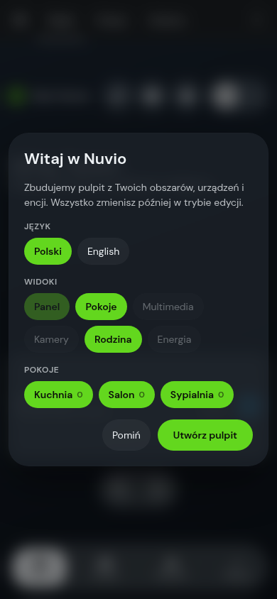

<p align="center">
  <picture>
    <source media="(prefers-color-scheme: dark)" srcset="docs/assets/logo-dark.png">
    
  </picture>
</p>

<p align="center"><strong>A glass-style Home Assistant dashboard that builds itself from your home.</strong></p>

<p align="center">
  <a href="https://hacs.xyz"></a>
  
  
  <a href="LICENSE"></a>
</p>

<p align="center"><b>English</b> · <a href="README.pl.md">Polski</a></p>

---

Nuvio is a complete dashboard — pages, navigation, cards and an in-place editor — shipped as a single
frontend plugin. It contains **no hard-coded entities**: on first start it reads your areas, devices
and entities from Home Assistant and generates the views. Everything can then be changed in edit mode.

## Screenshots

<p align="center">
  
  
</p>
<p align="center">
  
</p>
<p align="center">
  
  
</p>

## Features

- **Auto-generated dashboard** (dashboard strategy `custom:nuvio`): Home, Rooms (+ room detail), Media, Cameras, Family, Energy.
  Each view appears only if you have matching entities — missing integrations are simply hidden.
- **First-run wizard** (admins): language (Polski / English), views, visible rooms.
- **Edit mode**: drag & drop, hide/restore, S/M/L sizes, add tiles from any entity, swap entities, display styles with live preview,
  appearance (accent colour with automatic WCAG contrast, background photo / colour / gradient, dimming).
- **Per-user storage**: layout and appearance are stored per user in Home Assistant (`frontend/set_user_data`, key `nuvio_layout`) with a local fallback.
- **Light and dark mode**, touch friendly, reduced-motion aware.

## Installation

### HACS (custom repository)

1. HACS → ⋮ → *Custom repositories* → `https://github.com/kczepiec/nuvio`, category **Dashboard**.
2. Install **Nuvio**. HACS adds the resource `/hacsfiles/nuvio/nuvio.js`.
3. Settings → Dashboards → *Add dashboard* → *New dashboard from scratch*, open it, ⋮ → *Edit* → ⋮ → *Raw configuration editor* and paste:

   ```yaml
   strategy:
     type: custom:nuvio
   ```

4. Open the dashboard — the wizard starts on first visit.

### Manual

1. Copy the contents of `dist/` to `/config/www/nuvio/`.
2. Add the resource `/local/nuvio/nuvio.js` (type: **JavaScript module**).
3. Use the same `strategy` config as above.

## Configuration

Optional strategy options:

```yaml
strategy:
  type: custom:nuvio
  language: en        # pl | en (default: your HA language)
```

> [!TIP]
> To take over a generated dashboard as plain YAML, use *Take control* in the dashboard editor — all `custom:nuvio-*` cards keep working.

## Presets

Configuration (layout + appearance) can be exported/imported as JSON. Personal presets live outside the repository.

## Development

```bash
python3 tools/build.py   # -> dist/nuvio.js
python3 tools/guard.py   # fails if any house-specific id slipped into dist
```

Releases are built by GitHub Actions on `v*` tags.

## License & credits

Nuvio is released under the [MIT License](LICENSE).

Bundled third-party assets:
- [DM Sans](dist/assets/fonts/OFL.txt) — SIL Open Font License 1.1
- [Meteocons](dist/assets/meteocons/LICENSE) by Bas Milius — MIT
