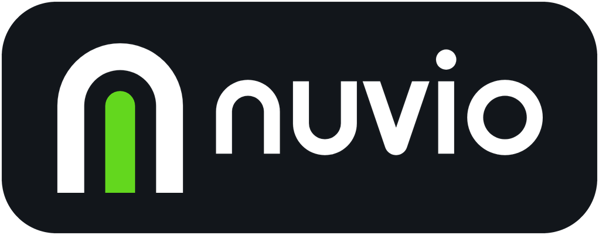

<p align="center">
  
</p>

<p align="center"><strong>Twój dom, spokojnie poukładany.</strong></p>

<p align="center">
  <a href="https://hacs.xyz"></a>
  
  
  <a href="LICENSE"></a>
</p>

<p align="center"><a href="README.md">English</a> · <b>Polski</b></p>

<p align="center">
  
  
</p>

## Czym jest Nuvio

Nuvio to szklany pulpit Home Assistant: widoki, nawigacja, karty i edytor na miejscu w jednej wtyczce frontendu. Nie zawiera żadnych encji na sztywno. Przy pierwszym uruchomieniu odczytuje obszary, urządzenia i encje z Home Assistant i sam buduje widoki. Potem wszystko zmienisz w trybie edycji.

## Najważniejsze funkcje

- **Pulpit generowany automatycznie.** Panel, Pokoje, Multimedia, Kamery, Rodzina i Energia pojawiają się, gdy masz pasujące encje. Brakujące integracje są po prostu ukrywane.
- **Kreator pierwszego uruchomienia.** Konfiguracja krok po kroku z podglądem na żywo: język, widoki, pokoje, kolor akcentu i tło.
- **Edycja na miejscu.** Przeciąganie, rozmiary kafli, galeria komponentów, kolor akcentu i tło.
- **Wiele kart, jeden styl.** Ponad 60 kart do świateł, klimatu, energii, multimediów, kamer, osób i nie tylko; każdej można użyć samodzielnie w zwykłym pulpicie. Zobacz [Komponenty](docs/pl/components.md).
- **Domyślnie wspólny.** Administrator ustawia jeden dashboard dla wszystkich, a wybrana osoba może dostać własny układ. Zobacz [Wspólny dashboard](docs/pl/features.md#wspólny-dashboard).
- **Tryb tabletu ściennego.** Spokojny wygaszacz z zegarem, datą i zdjęciem, z opcjonalną blokadą PIN-em. Zobacz [Tryb tabletu ściennego](docs/pl/features.md#tryb-tabletu-ściennego).
- **Kopia układu.** Eksport i import całego układu jako JSON z wersją. Zobacz [Kopia układu](docs/pl/features.md#kopia-układu).
- **Po polsku i po angielsku.** Język zmienisz w każdej chwili, bez przeładowania. Zobacz [Język](docs/pl/configuration.md#język).
- **Tryb jasny i ciemny**, obsługa dotyku i klawiatury w trybie edycji, szacunek dla „ogranicz ruch”.

## Szybka instalacja

1. W HACS otwórz menu, wybierz *Niestandardowe repozytoria*, dodaj `https://github.com/kczepiec/nuvio` z kategorią **Dashboard**, a potem zainstaluj **Nuvio**.
2. W Home Assistant wejdź w Ustawienia → Pulpity → *Dodaj pulpit* → *Nowy pulpit od zera*, otwórz go, ⋮ → *Edytuj* → ⋮ → *Edytor konfiguracji* i wklej:

   ```yaml
   strategy:
     type: custom:nuvio
   ```

3. Otwórz pulpit. Przy pierwszej wizycie uruchomi się kreator.

Instalację ręczną i polecane dodatki opisuje [docs/pl/installation.md](docs/pl/installation.md).

## Minimalna konfiguracja

Nuvio działa bez opcji. Jedno opcjonalne ustawienie wybiera domyślny język pulpitu; osobisty wybór w Ustawieniach i tak wygrywa.

```yaml
strategy:
  type: custom:nuvio
  language: pl        # pl | en
```

Więcej w [docs/pl/configuration.md](docs/pl/configuration.md).

## Dokumentacja

| Strona | Co zawiera |
|---|---|
| [Instalacja](docs/pl/installation.md) | HACS, instalacja ręczna i polecane dodatki |
| [Konfiguracja](docs/pl/configuration.md) | Opcje strategii, język, presety |
| [Przewodnik po funkcjach](docs/pl/features.md) | Wspólny dashboard, tryb tabletu ściennego, kopia układu |
| [Komponenty](docs/pl/components.md) | Każda karta, jej encje i opcje |
| [Plan rozwoju](docs/pl/roadmap.md) | Co jest planowane, a co gotowe |
| [Lista zmian](CHANGELOG.pl.md) | Opis zmian w każdej wersji |
| [Rozwój](docs/pl/development.md) | Budowanie, układ źródeł i wydania |
| [Współpraca](CONTRIBUTING.md) | Zgłaszanie błędów i wysyłanie zmian (po angielsku) |
| [Zasady projektu](DESIGN.md) | Zasady interfejsu, które spełnia każda funkcja (po angielsku) |
| [Zasady użycia logo](assets/brand/guide/usage-guide.md) | Jak umieszczać logo Nuvio (po angielsku) |

## Licencja i podziękowania

Nuvio jest udostępniany na [licencji MIT](LICENSE).

Dołączone zasoby zewnętrzne:
- [DM Sans](dist/nuvio-font-OFL.txt): SIL Open Font License 1.1
- [Meteocons](dist/nuvio-meteo-LICENSE.txt): Bas Milius, MIT
- [Domyślne zdjęcie tła](dist/CREDITS.md): „House in forest”, autor Flo Pappert, CC0 1.0 (przez Wikimedia Commons)
