<p align="center">
  <picture>
    <source media="(prefers-color-scheme: dark)" srcset="docs/assets/logo-dark.png">
    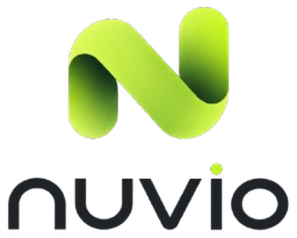
  </picture>
</p>

<p align="center"><strong>Szklany pulpit Home Assistant, który sam buduje się z Twojego domu.</strong></p>

<p align="center">
  <a href="https://hacs.xyz"></a>
  
  
  <a href="LICENSE"></a>
</p>

<p align="center"><a href="README.md">English</a> · <b>Polski</b></p>

---

Nuvio to kompletny pulpit (widoki, nawigacja, karty i edytor na miejscu) w jednej wtyczce frontendu.
Nie zawiera **żadnych encji na sztywno**: przy pierwszym uruchomieniu odczytuje obszary, urządzenia i encje
z Home Assistant i generuje widoki. Potem wszystko zmienisz w trybie edycji.

## Zrzuty ekranu

<p align="center">
  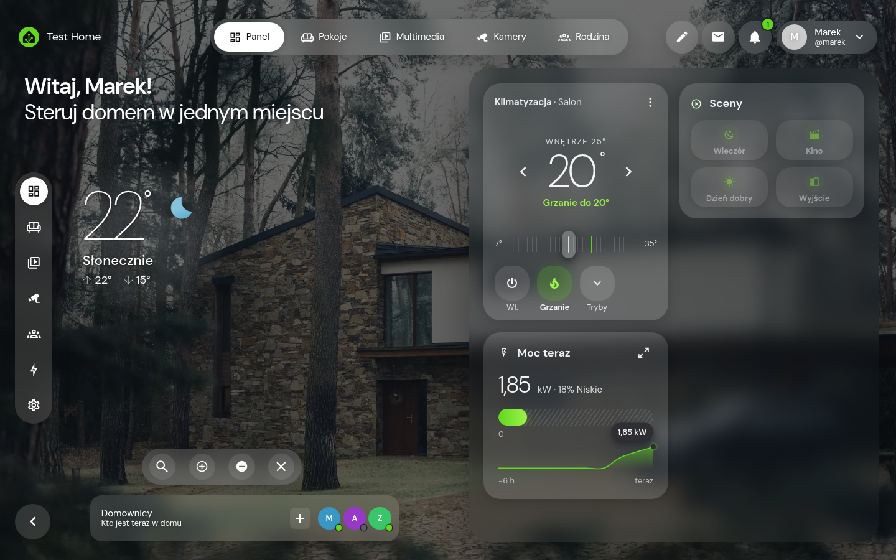
  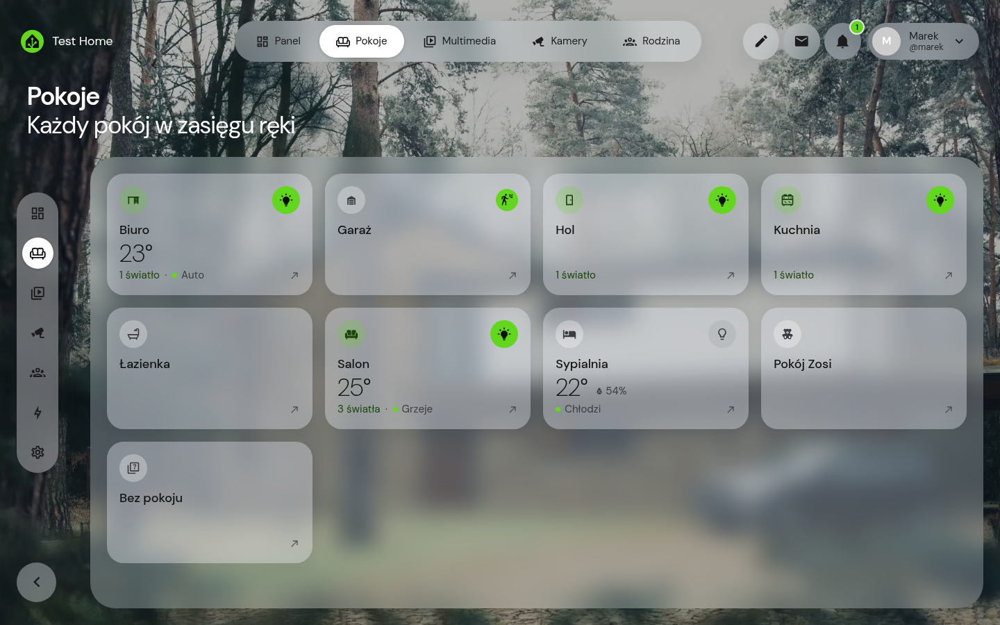
</p>
<p align="center">
  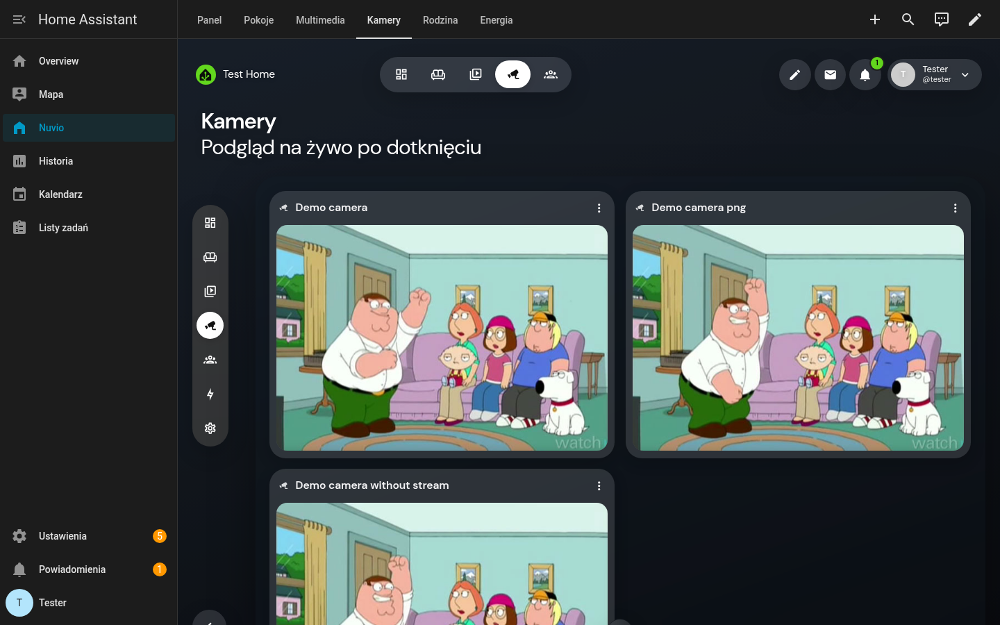
  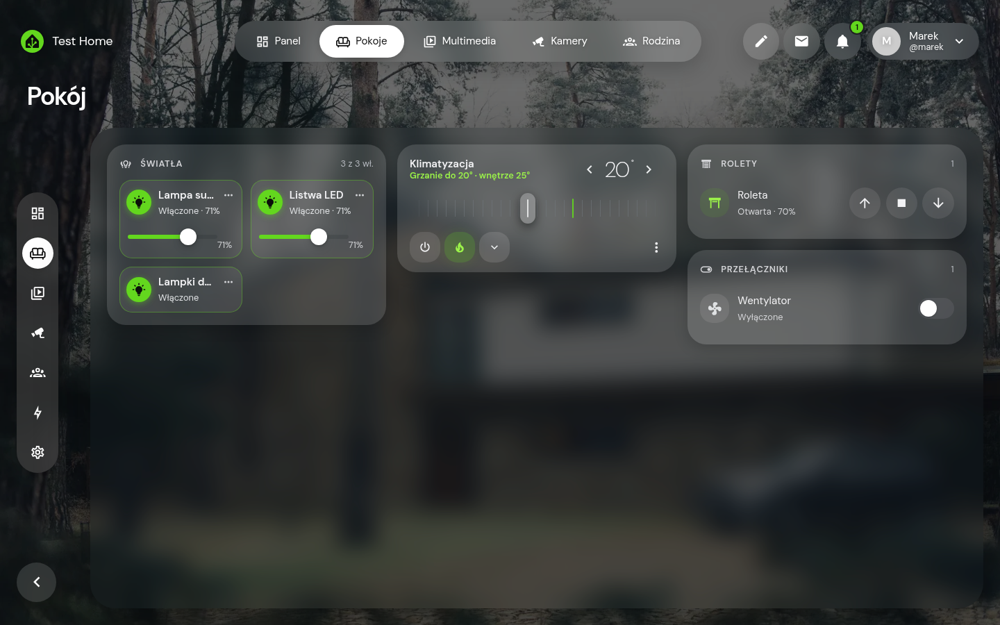
</p>
<p align="center">
  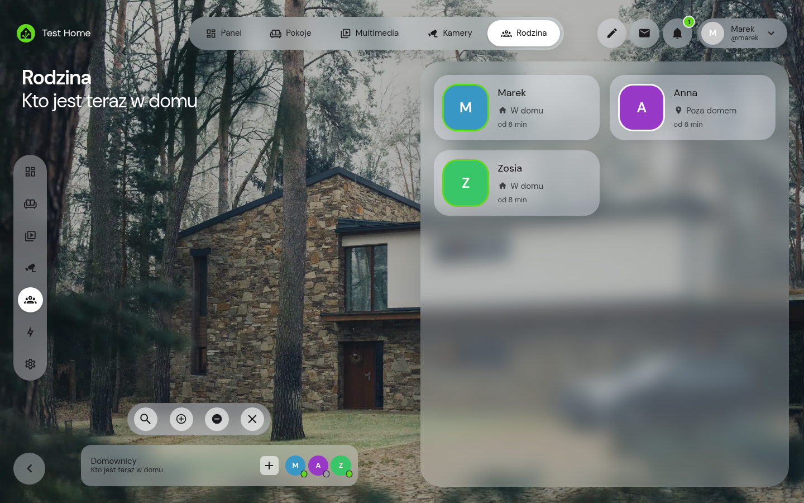
</p>
<p align="center">
  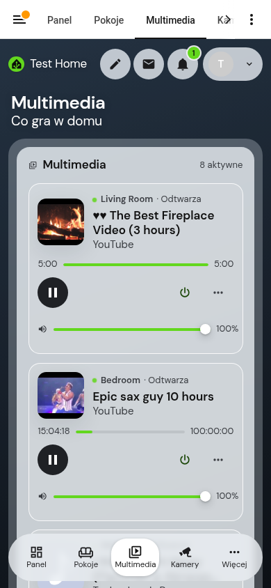
  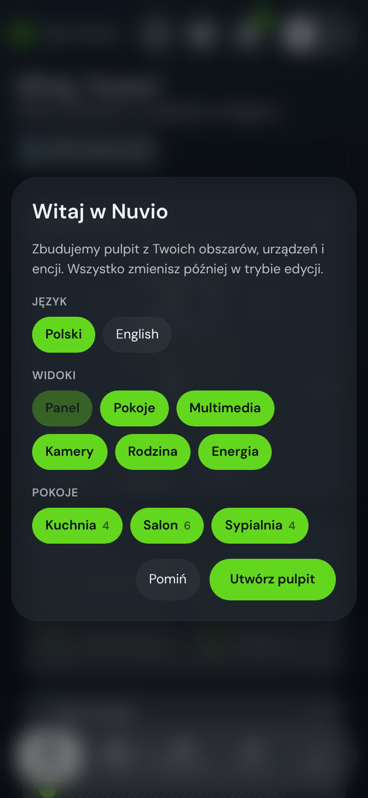
</p>

## Funkcje

- **Pulpit generowany automatycznie** (strategia `custom:nuvio`): Panel, Pokoje (+ szczegóły pokoju), Multimedia, Kamery, Rodzina, Energia.
  Widok pojawia się tylko, gdy masz pasujące encje; brakujące integracje są po prostu ukrywane.
- **Kreator pierwszego uruchomienia** (administrator): szklana konfiguracja krok po kroku z podglądem na żywo: język (Polski / English), widoki, widoczne pokoje, kolor akcentu i tło, a na końcu podsumowanie, z którego wrócisz do każdego kroku.
- **Puste pokoje**: pokój bez urządzeń proponuje **Importuj z obszaru** (podgląd encji z obszaru i pasujących po nazwie, z polami wyboru; **Wybierz encje**, aby wskazać dowolne encje ręcznie; opcjonalnie przypisanie ich też do obszaru w Home Assistant) oraz **Utwórz własny układ** (tryb edycji z pustym pokojem i galerią + Dodaj). Ustawienia obszaru zostają jako link pomocniczy.
- **Tryb edycji**: przeciąganie, ukrywanie i przywracanie, rozmiary S/M/L, dodawanie kafli z dowolnej encji, podmiana encji,
  style wyświetlania z podglądem na żywo, wygląd (kolor akcentu z automatycznym kontrastem WCAG, tło: zdjęcie / kolor / gradient, przyciemnienie).
- **Galeria komponentów (+ Dodaj)**: najpierw grupa **Podstawowe** (Suwak, Przycisk, Lista encji, Wybór, Licznik, Wskaźnik, z miniaturami na żywo, dostępne też w pokojach), potem **Karty** dla konkretnych rodzajów urządzeń. Formularz komponentu nie ma wyboru trybu wyświetlania; prawdziwe warianty (suwak poziomy lub pionowy, przycisk jako kafel lub wiersz, wybór jako przyciski lub lista) są w **Opcjach komponentu**.
  <br>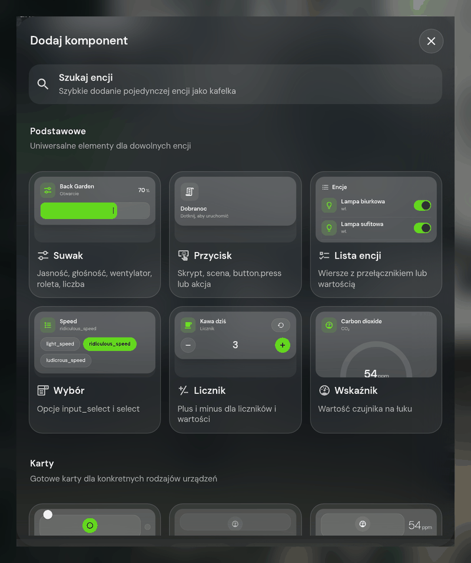
- **Kopia układu** (administrator): eksport i import całego układu jako JSON z wersją w **Wygląd → Kopia układu**, z opcją Zastąp albo Połącz i przywracaniem jednym kliknięciem. Zobacz [Kopia układu](#kopia-układu).
- **Tryb tabletu ściennego** (domyślnie wyłączony): po bezczynności pojawia się szklany wygaszacz z zegarem, datą i zdjęciem, który przyciemnia ekran; wybudza go dotyk lub czujnik ruchu. Czas bezczynności, przyciemnienie, źródło zdjęcia i czujnik ustawisz w **Wygląd → Tryb tabletu ściennego**. Zobacz [Tryb tabletu ściennego](#tryb-tabletu-ściennego).
- **Wspólny dashboard**: domyślnie wszyscy widzą ten sam dashboard, który ustawia administrator. W **Ustawienia → Użytkownicy** administrator może odznaczyć osobę, żeby miała własny układ i sama go edytowała. Zobacz [Wspólny dashboard](#wspólny-dashboard).
- **Interfejs po polsku i angielsku**: karty, tryb edycji i wygląd w języku wybranym w kreatorze (albo `language:` / profil HA); liczby i daty w tym samym formacie.
- **Tryb edycji z klawiatury**: strzałki na uchwycie kafla przesuwają go, strzałki góra/dół zmieniają kolejność encji na listach.
- **Tryb jasny i ciemny**, obsługa dotyku, szacunek dla „ogranicz ruch”.

## Komponenty

Każdej karty można użyć samodzielnie jako `custom:nuvio-<nazwa>-card` (np. w zwykłym pulpicie po *Przejmij kontrolę*). Zrzuty: ciemny motyw, domyślne tło, dane demo.

<details open>
<summary><b>Dom i klimat</b></summary>

<table>
<tr>
<td width="50%" valign="top">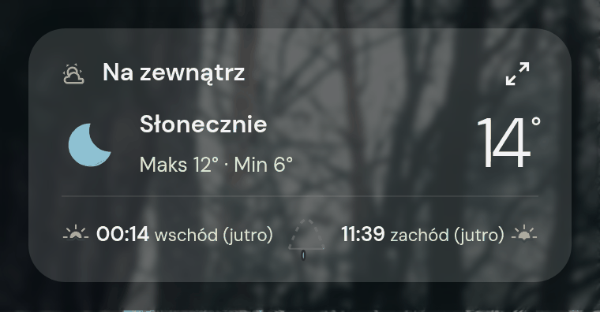<br><b>Pogoda</b> <code>custom:nuvio-weather-card</code><br>Bieżąca pogoda, prognoza godzinowa, wschód i zachód słońca; po dotknięciu szczegóły dni. <code>weather.*</code>, opcjonalny czujnik temperatury, <code>sun.sun</code>.</td>
<td width="50%" valign="top">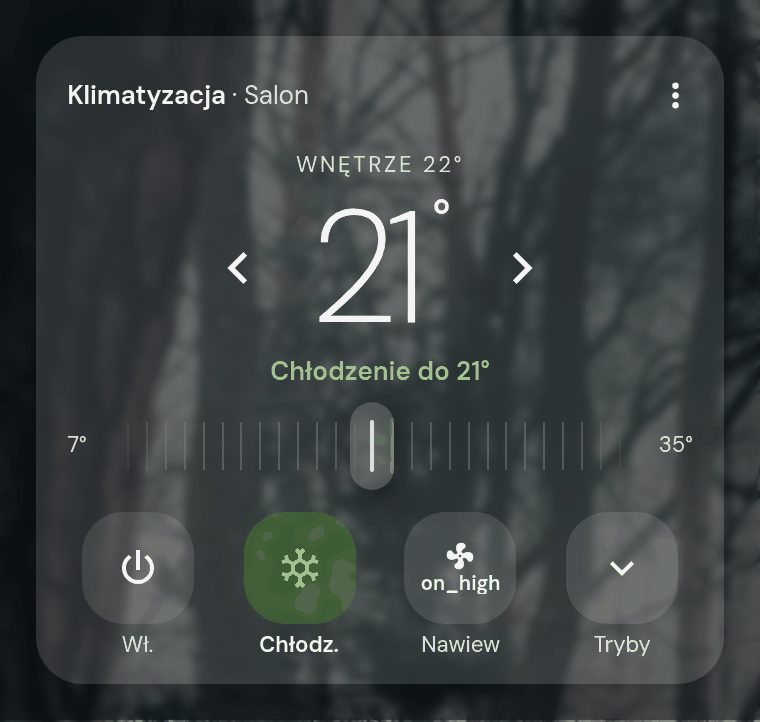<br><b>Klimatyzacja</b> <code>custom:nuvio-ac-card</code><br>Duża temperatura docelowa z suwakiem, tryby HVAC, nawiew i lamele. Przesuń suwak w bok, przytrzymaj temperaturę po szczegóły. <code>climate.*</code>.</td>
</tr>
<tr>
<td width="50%" valign="top">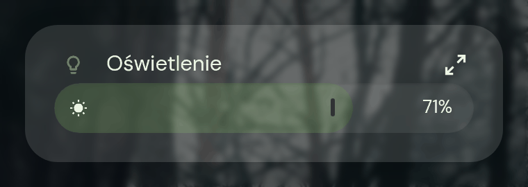<br><b>Oświetlenie</b> <code>custom:nuvio-light-card</code><br>Suwak jasności jednego światła. <code>light.*</code>.</td>
<td width="50%" valign="top">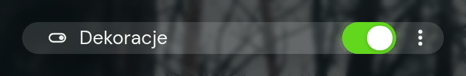<br><b>Przełącznik</b> <code>custom:nuvio-switch-card</code><br>Przełącznik w stylu glass jako wiersz lub kafel. <code>switch.*</code>, <code>input_boolean.*</code>, <code>fan.*</code> i inne encje wł./wył.</td>
</tr>
<tr>
<td width="50%" valign="top">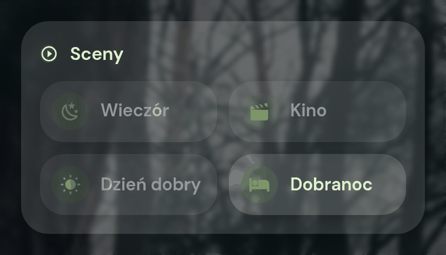<br><b>Sceny i skrypty</b> <code>custom:nuvio-scenes-card</code><br>Kilka scen lub skryptów jako przyciski z animacją potwierdzenia. <code>scene.*</code>, <code>script.*</code>.</td>
<td width="50%" valign="top">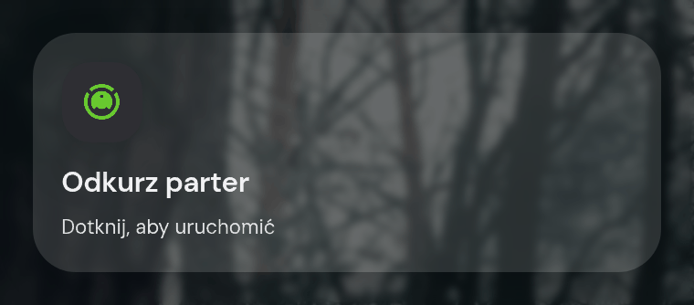<br><b>Skrypt</b> <code>custom:nuvio-script-card</code><br>Pojedynczy kafel uruchamiający skrypt. <code>script.*</code>, <code>scene.*</code>.</td>
</tr>
<tr>
<td width="50%" valign="top">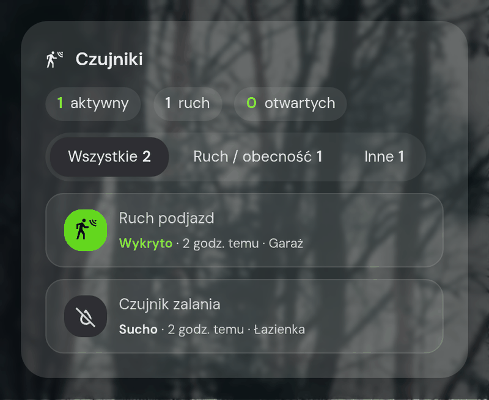<br><b>Czujniki</b> <code>custom:nuvio-sensors-card</code><br>Automatycznie wykryte czujniki ruchu, obecności, drzwi, okien, zalania i inne, z filtrami. <code>binary_sensor.*</code>.</td>
<td width="50%"></td>
</tr>
</table>
</details>

<details open>
<summary><b>Energia</b></summary>

<table>
<tr>
<td width="50%" valign="top">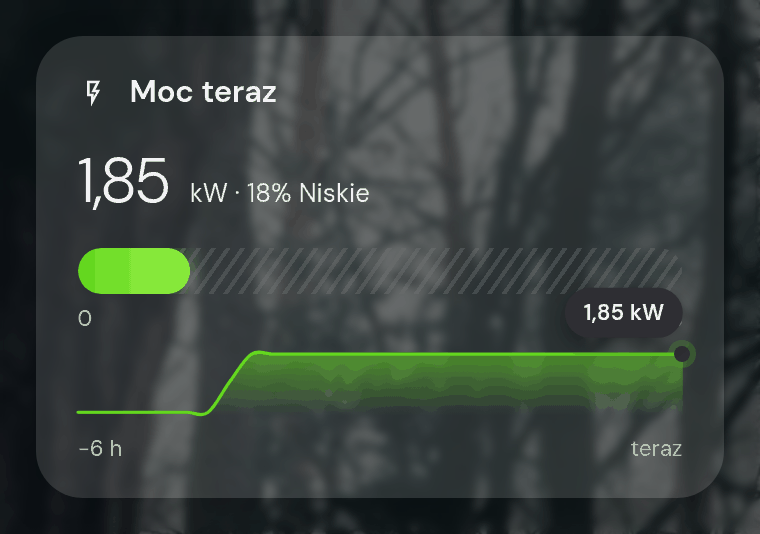<br><b>Moc teraz</b> <code>custom:nuvio-power-card</code><br>Moc chwilowa z linią z ostatnich godzin. <code>sensor.*</code> z <code>device_class: power</code>.</td>
<td width="50%" valign="top">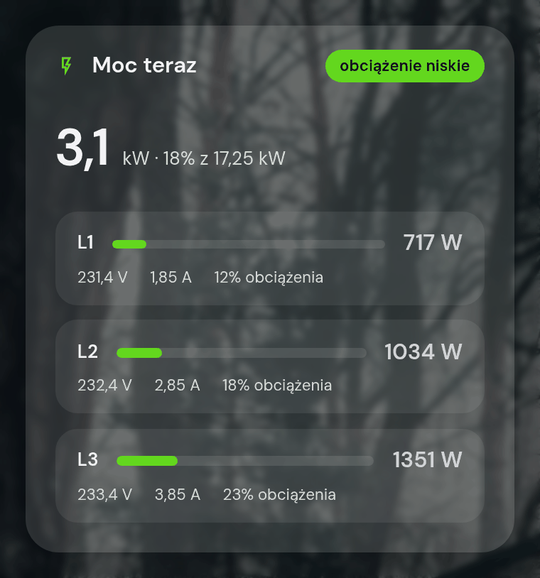<br><b>Fazy</b> <code>custom:nuvio-phases-card</code><br>Moc, napięcie i prąd na każdej fazie z paskami obciążenia. Czujniki mocy, napięcia i prądu dla faz.</td>
</tr>
<tr>
<td width="50%" valign="top">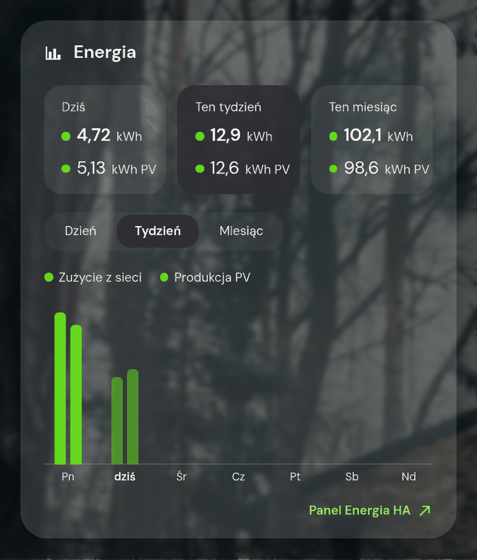<br><b>Energia (statystyki)</b> <code>custom:nuvio-energy-stats-card</code><br>Zużycie i produkcja: dziś, tydzień, miesiąc, z wykresem. Statystyki długoterminowe albo ustawienia panelu Energia HA.</td>
<td width="50%" valign="top">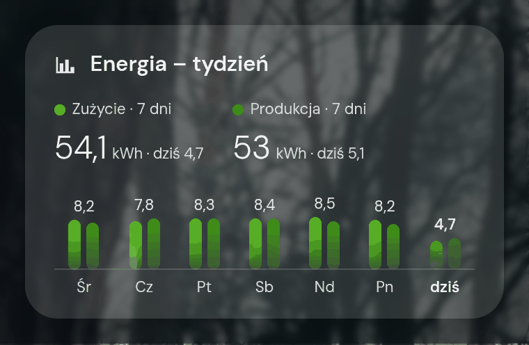<br><b>Energia: tydzień</b> <code>custom:nuvio-week-card</code><br>Zużycie z sieci i produkcja PV z 7 dni. Statystyki energii.</td>
</tr>
<tr>
<td width="50%" valign="top">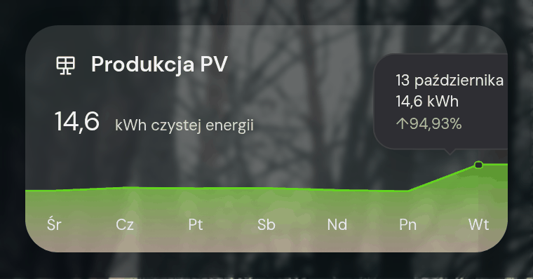<br><b>Solar</b> <code>custom:nuvio-solar-card</code><br>Produkcja PV z ostatnich dni jako wykres. Jedna statystyka energii i opcjonalny czujnik „dziś”.</td>
<td width="50%" valign="top">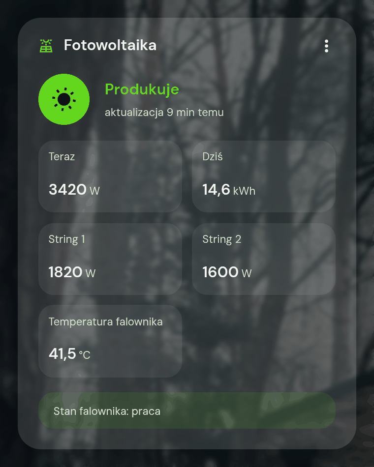<br><b>Fotowoltaika</b> <code>custom:nuvio-pv-card</code><br>Stan falownika, moc teraz, energia dziś, stringi i temperatura. Czujniki falownika.</td>
</tr>
<tr>
<td width="50%" valign="top">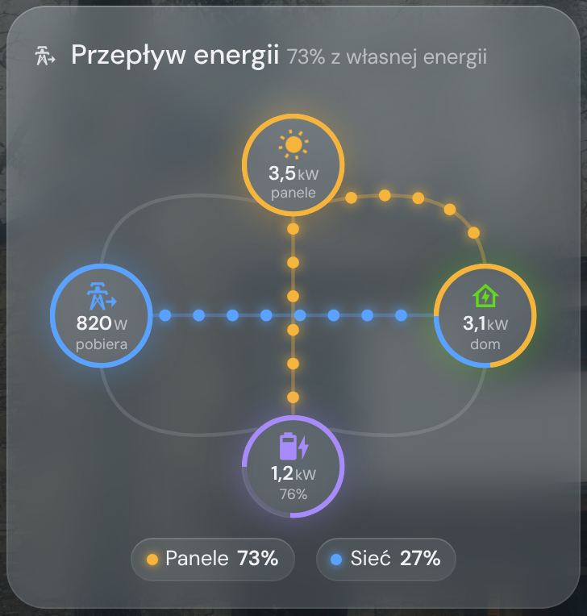<br><b>Przepływ energii</b> <code>custom:nuvio-flow-card</code><br>Sieć, panele, bateria i dom na jednym schemacie. Po liniach płyną świecące kropki, szybciej przy większej mocy; pierścień domu pokazuje, skąd bierze prąd, a pierścień baterii jej naładowanie. Czujniki mocy (W albo kW) sieci, paneli i baterii, poziom baterii, opcjonalnie zużycie domu.</td>
<td width="50%" valign="top"></td>
</tr>
</table>
</details>

<details open>
<summary><b>Multimedia i kamery</b></summary>

<table>
<tr>
<td width="50%" valign="top">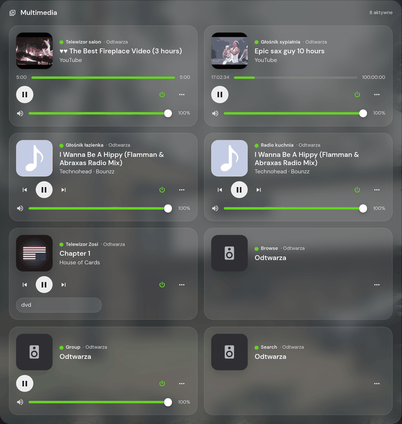<br><b>Multimedia</b> <code>custom:nuvio-players-card</code><br>Wszystkie odtwarzacze: okładka, tytuł, postęp, sterowanie, głośność i źródło. <code>media_player.*</code> (wykrywane automatycznie).</td>
<td width="50%" valign="top">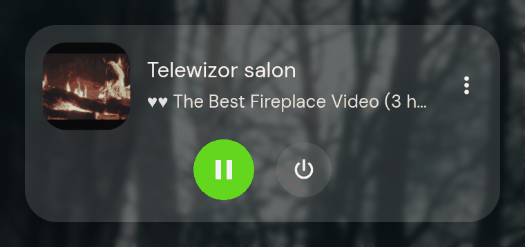<br><b>Odtwarzacz</b> <code>custom:nuvio-media-card</code><br>Kompaktowa karta jednego odtwarzacza. <code>media_player.*</code>.</td>
</tr>
<tr>
<td width="50%" valign="top">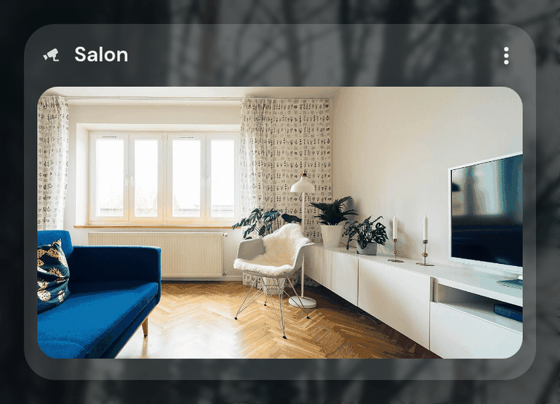<br><b>Kamera</b> <code>custom:nuvio-camera-card</code><br>Migawka odświeżana co kilka sekund, podgląd na żywo po dotknięciu. <code>camera.*</code>.</td>
<td width="50%" valign="top">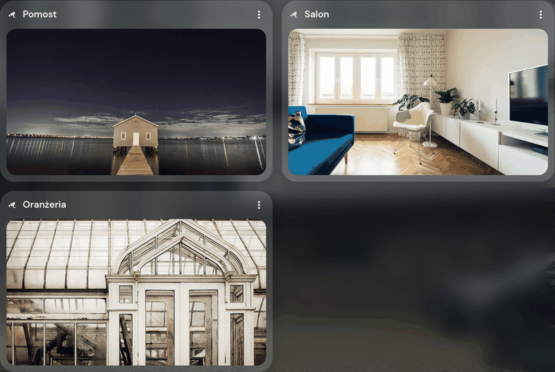<br><b>Kamery</b> <code>custom:nuvio-cameras-card</code><br>Działające kamery jako duże kafle, niedostępne zwinięte do chipów. <code>camera.*</code>.</td>
</tr>
</table>
</details>

<details open>
<summary><b>Domownicy i kalendarz</b></summary>

<table>
<tr>
<td width="50%" valign="top">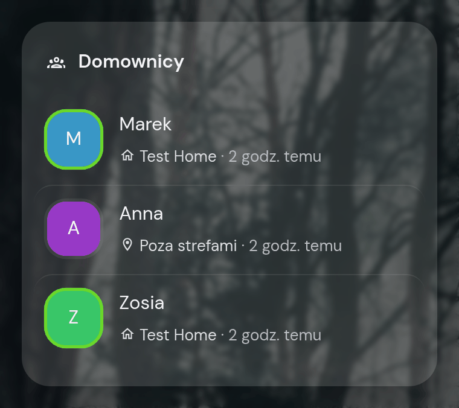<br><b>Domownicy</b> <code>custom:nuvio-people-card</code><br>Wszyscy z awatarem, strefą i czasem od zmiany. <code>person.*</code>, opcjonalnie <code>zone.*</code>.</td>
<td width="50%" valign="top">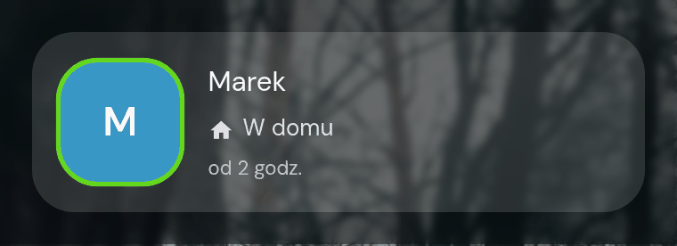<br><b>Osoba</b> <code>custom:nuvio-person-card</code><br>Jedna osoba z awatarem i strefą. <code>person.*</code>.</td>
</tr>
<tr>
<td width="50%" valign="top">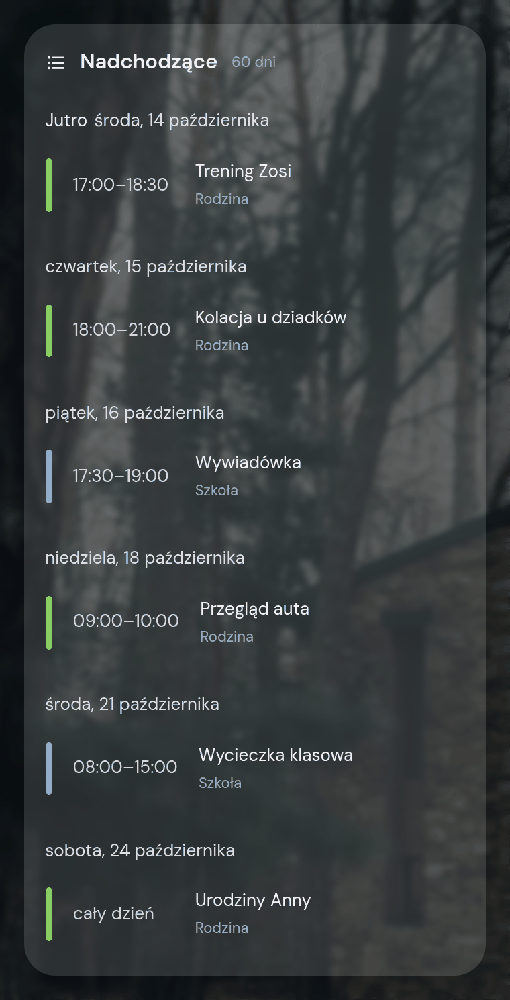<br><b>Agenda</b> <code>custom:nuvio-agenda-card</code><br>Nadchodzące wydarzenia pogrupowane po dniach, kolor na kalendarz. <code>calendar.*</code>.</td>
<td width="50%" valign="top">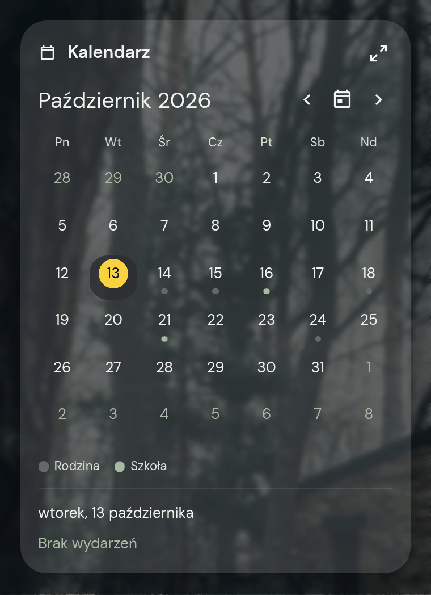<br><b>Miesiąc</b> <code>custom:nuvio-month-card</code><br>Siatka miesiąca z kropkami wydarzeń i listą wybranego dnia. <code>calendar.*</code>.</td>
</tr>
</table>
</details>

<details open>
<summary><b>Bezpieczeństwo i urządzenia</b></summary>

<table>
<tr>
<td width="50%" valign="top">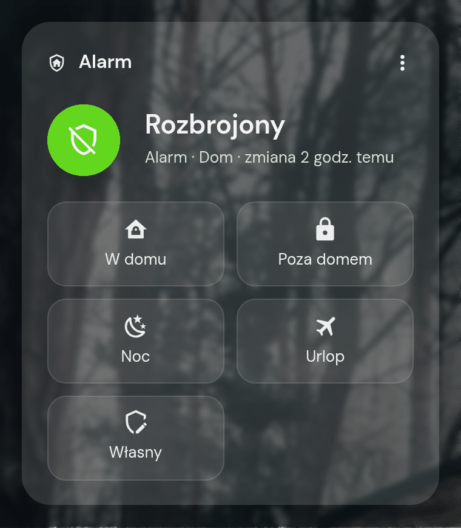<br><b>Alarm</b> <code>custom:nuvio-alarm-card</code><br>Stan alarmu i tryby uzbrajania wg obsługiwanych funkcji, z klawiaturą kodu. <code>alarm_control_panel.*</code>.</td>
<td width="50%" valign="top">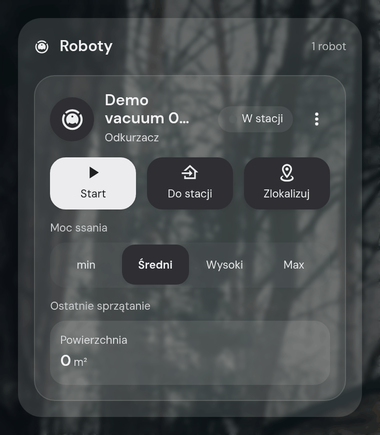<br><b>Roboty</b> <code>custom:nuvio-robots-card</code><br>Odkurzacze i kosiarki: stan, start, baza, lokalizacja, moc ssania i ostatnie sprzątanie. <code>vacuum.*</code>, <code>lawn_mower.*</code>.</td>
</tr>
<tr>
<td width="50%" valign="top">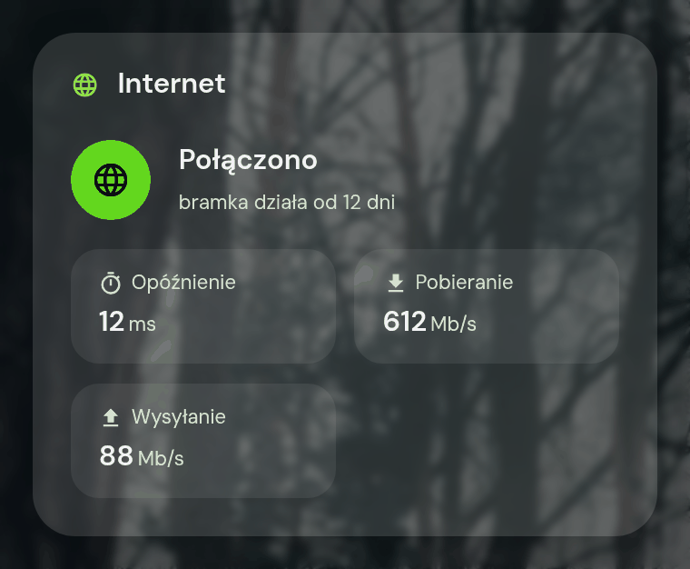<br><b>Sieć</b> <code>custom:nuvio-net-card</code><br>Stan internetu, opóźnienie i prędkość; inne sekcje: bramka, punkty dostępowe, Wi-Fi i klienci. Encje UniFi.</td>
<td width="50%"></td>
</tr>
</table>
</details>

<details open>
<summary><b>Pokoje i nawigacja</b></summary>

<table>
<tr>
<td width="50%" valign="top">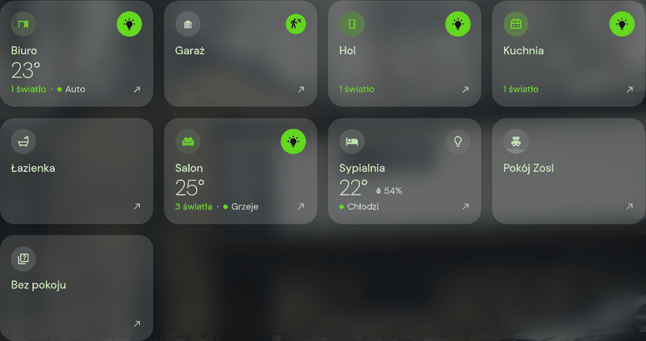<br><b>Pokoje</b> <code>custom:nuvio-areas-card</code><br>Wszystkie obszary HA: temperatura, wilgotność, światła, ruch, klimatyzacja. Rejestr obszarów.</td>
<td width="50%" valign="top">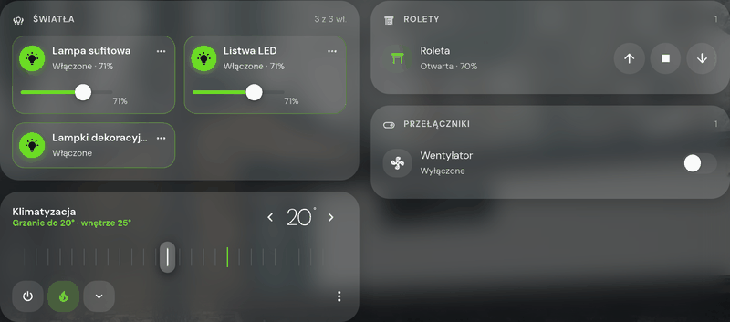<br><b>Pokój</b> <code>custom:nuvio-room-card</code><br>Wszystkie encje pokoju pogrupowane wg rodzaju (światła, klimatyzacja, rolety, przełączniki…). Adres <code>?area=<id></code>. Pusty pokój proponuje import z obszaru albo własny układ.<br>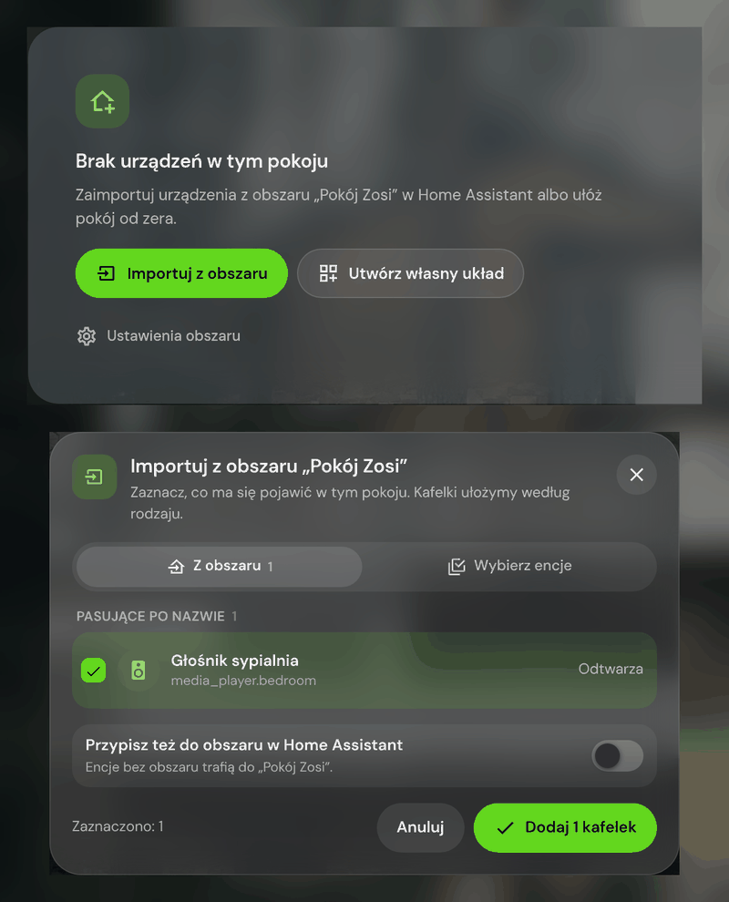</td>
</tr>
<tr>
<td width="50%" valign="top">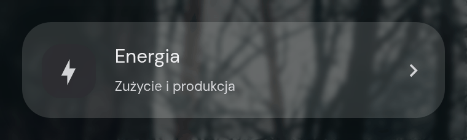<br><b>Link</b> <code>custom:nuvio-link-card</code><br>Kafel nawigacji lub akcji. Dowolna ścieżka lub akcja.</td>
<td width="50%"></td>
</tr>
</table>
</details>

<details open>
<summary><b>Podstawowe sterowanie</b></summary>

<table>
<tr>
<td width="50%" valign="top">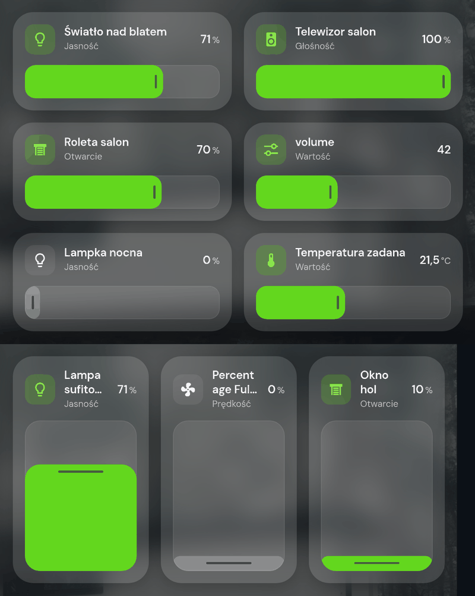<br><b>Suwak</b> <code>custom:nuvio-slider-card</code><br>Suwak do jasności, głośności, prędkości wentylatora, pozycji rolety lub wartości liczbowej, poziomy albo pionowy. <code>light.*</code>, <code>media_player.*</code>, <code>fan.*</code>, <code>cover.*</code>, <code>valve.*</code>, <code>input_number.*</code>, <code>number.*</code>.</td>
<td width="50%" valign="top">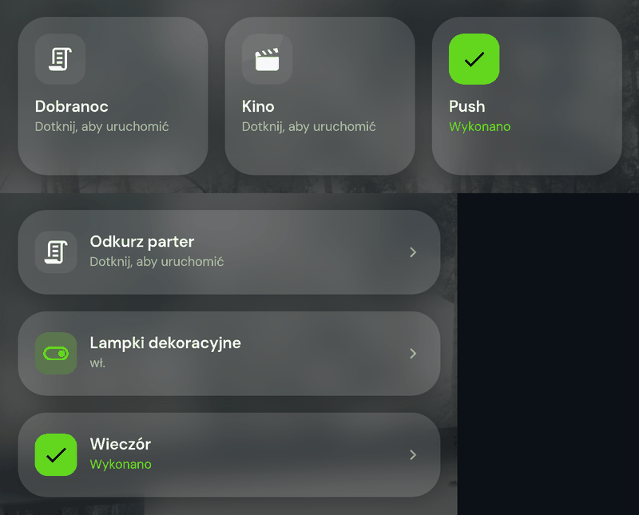<br><b>Przycisk</b> <code>custom:nuvio-button-card</code><br>Przycisk uruchamiający skrypt, scenę, przycisk lub dowolną akcję, jako kafel albo pigułka, z potwierdzeniem Wykonano. <code>script.*</code>, <code>scene.*</code>, <code>button.*</code>, <code>input_button.*</code>, <code>automation.*</code> lub dowolna <code>tap_action</code>.</td>
</tr>
<tr>
<td width="50%" valign="top">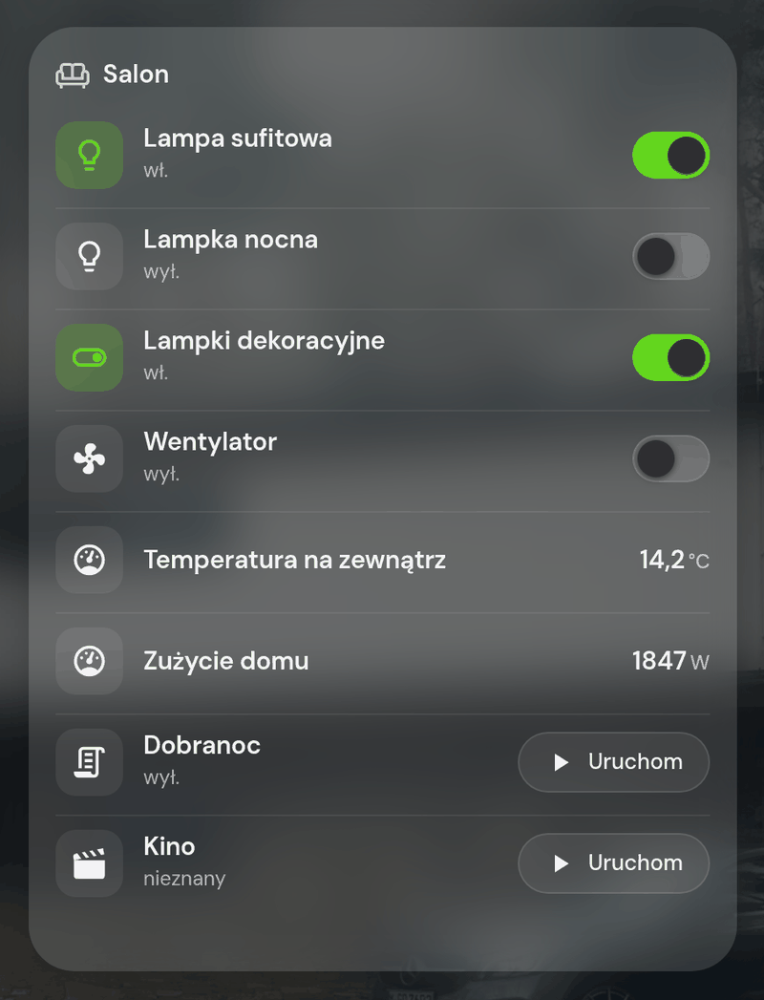<br><b>Lista encji</b> <code>custom:nuvio-entities-card</code><br>Lista encji z przełącznikiem, przyciskiem Uruchom lub wartością w każdym wierszu. <code>light.*</code>, <code>switch.*</code>, <code>fan.*</code>, <code>input_boolean.*</code>, <code>script.*</code>, <code>scene.*</code>, <code>button.*</code>, <code>sensor.*</code>, <code>binary_sensor.*</code> i inne encje tylko do odczytu.</td>
<td width="50%" valign="top">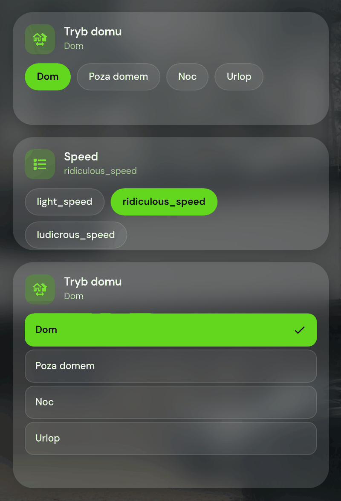<br><b>Wybór</b> <code>custom:nuvio-select-card</code><br>Wybór opcji jako chipy albo lista. <code>input_select.*</code>, <code>select.*</code>.</td>
</tr>
<tr>
<td width="50%" valign="top">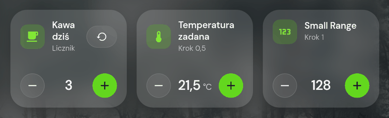<br><b>Licznik</b> <code>custom:nuvio-stepper-card</code><br>Licznik ze zwiększaniem, zmniejszaniem i resetem albo zmiana wartości o krok. <code>counter.*</code>, <code>input_number.*</code>, <code>number.*</code>.</td>
<td width="50%" valign="top">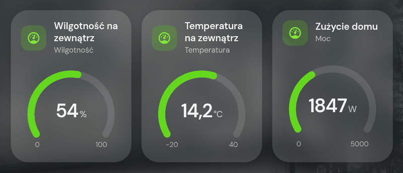<br><b>Wskaźnik</b> <code>custom:nuvio-gauge-card</code><br>Wskaźnik łukowy pokazujący wartość czujnika, z zakresem dobranym do jednostki. <code>sensor.*</code>, <code>input_number.*</code>, <code>number.*</code>.</td>
</tr>
</table>
</details>

**Pozostałe karty**

- `custom:nuvio-map-card`: natywna mapa HA w szklanej ramce (bez zrzutu: kafelki mapy wymagają internetu).
- `custom:nuvio-energy-card`: procent obciążenia (suma faz względem mocy maksymalnej) (bez zrzutu: poza siatką o stałej wysokości renderuje się niepoprawnie).
- `custom:nuvio-bars-card`: dzienne słupki zużycia ze statystyk (bez zrzutu: ten sam problem z wysokością).
  - `custom:nuvio-gauge-card`: wartość czujnika liczbowego na łuku.
- `custom:nuvio-page`: sam pełnoekranowy układ (pasek, szyna, nagłówek, panel kart); używają go wszystkie zrzuty powyżej.

### Więcej kart i biblioteka formularzy (1.2.0)

Siedem nowych kart w **+ Dodaj**, każda z podglądem na żywo i formularzem. Odpowiadają kartom Home Assistant o tej samej nazwie, w szkle Nuvio.

| Karta | Co robi | Opcje |
|---|---|---|
| `custom:nuvio-conditional-card` | Pokazuje swoje karty tylko przy spełnionych warunkach (w trybie edycji zawsze widoczne) | `cards`, `conditions` (`state`, `state_not`, `numeric_state` z `above` / `below`, `screen` z `media_query`, `user` z `users`, `and`, `or`) |
| `custom:nuvio-glance-card` | Kilka encji w rzędzie: ikona, nazwa i stan; dotknięcie otwiera szczegóły | `entities`, `title`, `columns`, `show_name`, `show_state` |
| `custom:nuvio-stat-card` | Minimum, średnia, maksimum i zmiana czujnika z wykresem, za 24 godziny, 7 lub 30 dni | `entity`, `name`, `icon`, `hours`, `decimals` |
| `custom:nuvio-humidifier-card` | Docelowa wilgotność na łuku, bieżąca wilgotność i pigułki trybów | `entity`, `name` |
| `custom:nuvio-timer-card` | Pozostały czas `timer` na łuku, ze startem, pauzą i anulowaniem | `entity`, `name`, `icon` |
| `custom:nuvio-logbook-card` | Ostatnie zmiany wybranych encji z czasem względnym | `entities`, `title`, `hours`, `max` |
| `custom:nuvio-webpage-card` | Dowolny adres `https://`, `http://` albo `/local/` w ramce | `url`, `title`, `aspect_ratio` albo `height` |

Formularze komponentów korzystają teraz z jednej biblioteki formularzy (`hgForm`): pola tekstowe, liczbowe, obszary tekstu (styl kodu dla YAML i JSON), szklane przełączniki, szklane listy wyboru i zwijana sekcja *Zaawansowane*, więc nie zostaje żaden przeglądarkowy checkbox, lista podpowiedzi ani trójkącik rozwijania.

### Kontenery układu (1.1.0)

Siatka, stos pionowy i stos poziomy działają jak w Home Assistant, ale w szkle Nuvio. Są pierwszą grupą w **+ Dodaj**, w sekcji *Układ*. Formularz kontenera pokazuje jego karty: dodasz dowolny komponent, kafelek albo kartę z HA, edytujesz kartę w jej własnym formularzu, zmienisz kolejność przeciągając, zduplikujesz, usuniesz, a w siatce ustawisz, ile kolumn zajmuje karta. Kontenery można zagnieżdżać do trzech poziomów. Kartę z panelu przeniesiesz do kontenera z jej formularza, a kartę z kontenera wyjmiesz z powrotem na panel.

**Karta z HA (YAML)** przyjmuje YAML (albo JSON), który edytor kart Home Assistant pokazuje po wybraniu *Pokaż edytor kodu*. `grid`, `vertical-stack` i `horizontal-stack` stają się kontenerami Nuvio z tymi samymi kartami, każda inna karta jest pokazana bez zmian. Ta sama zamiana działa dla tych typów w konfiguracji strony Nuvio; `keep_ha: true` zostawia oryginalną kartę Home Assistant. Przykład jest w [docs/examples/containers.yaml](docs/examples/containers.yaml).

| Karta | Co robi | Opcje |
|---|---|---|
| `custom:nuvio-grid-card` | Karty w kolumnach; na wąskim ekranie mniej kolumn | `cards`, `columns` (1 do 6, 0 = automatycznie), `min_width`, `square`, `gap`, `glass`, `title`; dla karty `span` |
| `custom:nuvio-stack-card` | Karty jedna pod drugą albo obok siebie w jednym szkle; obok siebie przechodzą w pion poniżej `wrap_below` px | `cards`, `direction`, `gap`, `ratio` (np. `[2, 1]`), `wrap_below`, `divider`, `glass`, `title` |

### Karty ogólne i kontenery (0.16.0)

Dwanaście kart zbudowanych wyłącznie ze wspólnych szklanych klocków, więc wyglądają jak projekt wzorcowy i działają z dowolną encją pasującej domeny. Każda dopasowuje się do szerokości: mała (do 220 px) chowa teksty pomocnicze, duża (od 420 px) pokazuje więcej szczegółów. Działają też w zwykłym widoku Home Assistant, gdzie same rozmywają tło. Gotowy pulpit złożony tylko z nich jest w [docs/examples/inspiration-dashboard.yaml](docs/examples/inspiration-dashboard.yaml) (działa z integracją demo HA).

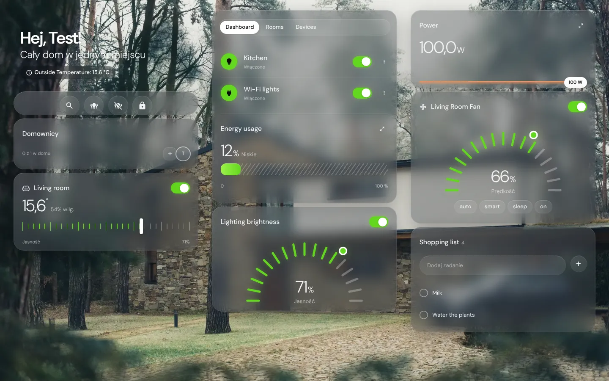

| Karta | Co pokazuje | Główne opcje |
|---|---|---|
| `custom:nuvio-hero-card` | Duże powitanie z imieniem zalogowanej osoby i hasłem, opcjonalnie zdjęcie i jeden stan | `title` (`{name}`), `subtitle`, `image`, `entity` |
| `custom:nuvio-toggle-card` | Jedno urządzenie w wierszu: ikona, nazwa i stan, przełącznik, menu ⋮ | `entity`, `name`, `icon` |
| `custom:nuvio-progress-card` | Wartość na grubym limonkowym pasku, pomarańczowym albo czerwonym powyżej progów | `entity`, `min`, `max`, `warn`, `bad`, `unit` |
| `custom:nuvio-arc-card` | Jasność, prędkość, pozycja, głośność albo liczba na przeciąganym łuku | `entity` (światło, wentylator, roleta, odtwarzacz, liczba) |
| `custom:nuvio-chart-card` | Obszar, linia albo słupki z historii dowolnego czujnika, z ostatnią wartością | `entity`, `hours`, `style: area / line / bars`, `tone: solar` |
| `custom:nuvio-room-compact-card` | Temperatura, wilgotność, przełącznik i linijka jasności | `name`, `temperature`, `humidity`, `entity` |
| `custom:nuvio-actions-card` | Szklana pigułka z okrągłymi przyciskami: sceny, skrypty, usługi, przejścia | `actions: [{ entity }, { icon, name, service, data }, { navigate }]` |
| `custom:nuvio-family-card` | Awatary, kto jest w domu, przycisk dodania osoby | `persons` (puste = wszyscy) |
| `custom:nuvio-cover-card` | Pozycja rolety lub bramy na przeciąganym pasku, otwórz, zatrzymaj, zamknij | `entity` |
| `custom:nuvio-lock-card` | Stan zamka; odblokowanie pyta o potwierdzenie albo o kod, gdy zamek go wymaga | `entity`, `confirm` |
| `custom:nuvio-fan-card` | Prędkość wentylatora na łuku i tryby jako pigułki | `entity` |
| `custom:nuvio-todo-card` | Lista zadań: dodawanie i odhaczanie | `entity`, `show_done` |
| `custom:nuvio-stack-card` | Kilka kart w jednym szkle, pionowo albo poziomo (karty Nuvio i zwykłe karty HA) | `cards`, `direction`, `glass`, `title` |
| `custom:nuvio-tabs-card` | Pigułki (Panel / Pokoje / Urządzenia) przełączające zestawy kart | `tabs: [{ label, icon, cards }]` |

Wszystkie są też w galerii *Dodaj komponent* w edytorze Nuvio.

### Pokoje, AGD i zgodność z Home Glass (0.7.0)

Wszystkie są w **+ Dodaj** w trybie edycji, z podglądem, pełnym formularzem ustawień i polem **Zaawansowana konfiguracja (JSON)** na każdą inną opcję karty (etykiety, kolory, progi, akcje). Wszystko zapisuje się w układzie, więc eksport i import w Kopii układu to przenoszą.

| Komponent | Karta | Ustawienia w formularzu |
|---|---|---|
| Pokoje | `custom:nuvio-areas-card` | ścieżka widoku pokoju; nazwy, ikony, kolejność, czujniki temperatury i wilgotności oraz pokoje własne w Wygląd, Pokoje |
| Pokój | `custom:nuvio-room-card` | pokój do pokazania (albo pokój z adresu) |
| Urządzenie AGD | `custom:nuvio-appliance-card` | dowolna encja urządzenia; pralka, suszarka i zmywarka pokazują stan, program, czas do końca i postęp |
| Ciepła woda | `custom:nuvio-cwu-card` | podgrzewacz, stan grzania, moc, czas nagrzewania, zużycie, utrzymanie temperatury, przełączniki |
| Schody | `custom:nuvio-stairs-card` | światło i czujnik ruchu na dole i na górze, grupa świateł, automatyzacja sekwencji |
| Ceny paliw | `custom:nuvio-fuel-card` | czujniki cen z etykietami i opcjonalny czujnik zmiany na jutro |
| Klimatyzacja (karta) | `custom:nuvio-ac-card` | encja climate, tytuł |
| Pilot klimatyzacji | `custom:nuvio-acremote-card` | encja climate, tytuł |
| Energia, tydzień | `custom:nuvio-week-card` | czujniki zużycia i produkcji, liczba dni, cel po dotknięciu |
| Fazy | `custom:nuvio-phases-card` | moc, napięcie i prąd każdej fazy, maksymalna moc łączna i fazy |
| Fotowoltaika | `custom:nuvio-pv-card` | moc, produkcja dziś, stan i temperatura falownika, stringi |
| Przepływ energii | `custom:nuvio-flow-card` | moc sieci (+ pobór, − oddawanie, kilka czujników się sumuje, np. fazy) albo osobne czujniki oddawania, moc paneli (kilka się sumuje, np. falowniki), baterie każda osobno (listy `battery` i `battery_soc` w tej samej kolejności albo `batteries: [{ power, soc, name }]`, do 4), zużycie domu (puste = z bilansu), odwrócenie znaku sieci albo baterii |
| Sieć | `custom:nuvio-net-card` | sekcja (internet, brama, Wi-Fi, urządzenia, klienci), tytuł |
| Czujniki domu | `custom:nuvio-sensors-card` | rodzaje czujników, dodatkowe i pominięte czujniki |
| Skrót | `custom:nuvio-link-card` | tytuł, podtytuł, encja, ścieżka lub adres do otwarcia |
| Osoba | `custom:nuvio-person-card` | osoba, etykiety w domu i poza domem |

**Wygląd, Pokoje**: zmiana nazw, ikon i kolejności, ukrywanie pokoi, wybór czujnika temperatury i wilgotności na kaflu każdego pokoju (automatycznie, dowolny czujnik albo brak) oraz pokoje własne z dowolnymi encjami, niezależne od obszarów Home Assistant. Encje można też ręcznie przypisać do istniejących pokoi.

**Wygląd, Nagłówek i nawigacja**: tytuł i podtytuł domowników (albo bez paska domowników), ceny paliw w nagłówku pulpitu i cztery widoki na pasku telefonu.

**Wygląd, Galeria teł**: własne zdjęcia z adresu `/local/` albo `https://`; pojawiają się w sekcji Tło i w pokazie slajdów tabletu ściennego.

**Wygląd, Nagłówek i nawigacja** (0.8.0) ma też: encję pogody w nagłówku i opcjonalny czujnik z atrybutem `forecast` dla paska prognozy godzinowej, położenie paska domowników (po lewej albo przy panelu), oraz tabelę widoków z ikoną, krótką etykietą na pasek telefonu, liczbą kolumn na komputerze i tablecie (także w widokach wbudowanych), obecnością w pasku bocznym i kolejnością w nim. **Galeria teł** ma punkt ostrości bieżącego tła.

**Ustawienia** (0.9.0): Wygląd to teraz osobny panel ustawień z kartami: Wygląd, Widoki, Pokoje, Nagłówek i nawigacja, Tła, Wygaszacz i Kopia zapasowa. Tabela ustawień widoków ma podpisane kolumny, a na telefonie zamienia się w karty z etykietami.

**Więcej komponentów w + Dodaj** (0.9.0): światło z jasnością, termostat, duża wartość, wykres historii, drzwi i okna, baterie, odkurzacz, mini odtwarzacz, zegar, słońce, notatka, obraz lub strona oraz aktualizacje. Każdy ma podgląd na żywo, pola formularza i trafia do eksportu i importu.

### Planowane

Plan kolejnych funkcji; źródłem prawdy jest [docs/STATUS.md](docs/STATUS.md).

| Funkcja | Opis | Status |
|---|---|---|
| Karta Assist / głosowa | rozmowa z Home Assistant Assist w szklanej karcie, z odpowiedzią wyświetlaną na miejscu | gotowe w 0.10.0 |
| Centrum powiadomień | trwałe powiadomienia, słabe baterie, otwarte drzwi i niedostępne urządzenia w jednym panelu | planowane |
| Integracja z panelem Energia | źródła i urządzenia z ustawień Energii w HA zamiast ręcznie wskazanych czujników | w toku: karta Energia · tydzień czyta już zużycie, produkcję i cenę z ustawień Energii HA; karty mocy, faz i fotowoltaiki nadal używają wybranych czujników |
| Poprawka kart energy i bars | poprawne renderowanie `nuvio-energy-card` i `nuvio-bars-card` poza siatką o stałej wysokości | planowane |
| Konfiguracja karty mapy | jasna podpowiedź i zapasowy widok, gdy kafelki mapy są niedostępne, oraz zrzut w README | planowane |
| Układy per urządzenie | osobny układ dla telefonu, tabletu i komputera zamiast jednego wspólnego | planowane |
| Edytor motywu | własne rozmycie szkła, zaokrąglenia, czcionki i palety kolorów poza kolorem akcentu | planowane |
| Udostępnianie presetów | udostępnianie układu i wyglądu jako presetów, z galerią presetów społeczności do importu | planowane |
| Biblioteka komponentów i nowy wygląd | wspólne klocki (szkło, przyciski, przełączniki, pigułki, nakładki), nowe karty ogólne, płynne animacje, aktualizacja na żywo bez przerysowania karty, rozmiary S, M i L dla szerokiego i wąskiego panelu, szybsze ładowanie | gotowe w 1.0.0: karty w osobnych plikach w 0.11.2, nowe szkło i tokeny projektu w 0.12.0, klocki i aktualizacja na żywo w 0.13.0, nakładki w 0.14.0, wszystkie karty na wspólnym wyglądzie i aktualizacji na żywo w 0.15.0, 12 kart ogólnych, stos i zakładki w 0.16.0, mniejsza paczka i wstrzymane karty poza ekranem w 1.0.0 |
| Blokada wygaszacza (BETA) | po dotknięciu wygaszacza okrągły szklany pinpad na rozmytym tle, kropki PIN-u nad nim i przycisk Zablokuj pod spodem; ustawienia PIN-u, czasu blokady i włącz/wyłącz | gotowe w 1.3.0, animacja odblokowania w 1.3.1 |
| Wspólny dashboard | jeden dashboard dla wszystkich użytkowników Home Assistant, ustawiany przez administratora, z możliwością odznaczenia osoby, która dostaje własny układ do edycji (Ustawienia → Użytkownicy) | gotowe w 1.4.0 |
| Widoczność widoków dla osób | wybór, kto widzi który widok; domyślnie każdy widok widzą wszyscy (Ustawienia → Widoki) | gotowe w 1.5.0 |
| Role i uprawnienia | uprawnienia osób poza widokami: kto może edytować wspólny dashboard, otwierać Ustawienia albo zdejmować blokadę PIN-em, ukryte karty lub pokoje dla wybranych osób | planowane |
| Przegląd dostępności | etykiety dla czytników ekranu, kolejność fokusu i audyt kontrastu we wszystkich kartach i trybie edycji | planowane |

Gotowe z poprzedniego planu: edytor widoków (Ustawienia → Widoki), pełne tłumaczenie polskie / angielskie, eksport i import konfiguracji (Ustawienia → Kopia zapasowa), podpowiedzi dla pustego widoku Panel, tryb tabletu ściennego (Ustawienia → Wygaszacz).

## Instalacja

### HACS (własne repozytorium)

1. HACS → ⋮ → *Niestandardowe repozytoria* → `https://github.com/kczepiec/nuvio`, kategoria **Dashboard**.
2. Zainstaluj **Nuvio**. HACS doda zasób `/hacsfiles/nuvio/nuvio.js`.
3. Ustawienia → Pulpity → *Dodaj pulpit* → *Nowy pulpit od zera*, otwórz go, ⋮ → *Edytuj* → ⋮ → *Edytor konfiguracji* i wklej:

   ```yaml
   strategy:
     type: custom:nuvio
   ```

4. Otwórz pulpit. Przy pierwszej wizycie uruchomi się kreator.

### Ręcznie

1. Pobierz archiwum źródeł najnowszego wydania (GitHub, Releases, Source code) i skopiuj zawartość jego folderu `dist/` (`nuvio.js` oraz pliki `nuvio-font-*`, `nuvio-bg-*`, `nuvio-meteo-*`, wszystkie bez podfolderów) do `/config/www/nuvio/`. Wydania nie mają załączonych plików.
2. Dodaj zasób `/local/nuvio/nuvio.js` (typ: **moduł JavaScript**).
3. Użyj tej samej konfiguracji `strategy` co wyżej.

## Polecane dodatki

Nuvio działa samodzielnie, ale pełnoekranowy wygląd ze zrzutów uzyskasz z tymi pakietami z HACS:

| Pakiet | Po co |
|---|---|
| [kiosk-mode](https://github.com/NemesisRE/kiosk-mode) | Ukrywa nagłówek i/lub pasek boczny Home Assistanta, więc widać tylko pulpit Nuvio (tablety ścienne, telefony). Nawigacja Nuvio współpracuje z kiosk-mode. |
| [custom-sidebar](https://github.com/elchininet/custom-sidebar) | Ukrywa lub porządkuje pozycje paska bocznego HA per użytkownik lub urządzenie, jeśli wolisz go zostawić, ale odchudzić. |
| [browser_mod](https://github.com/thomasloven/hass-browser_mod) *(opcjonalnie)* | Zamienia przeglądarkę w sterowalne urządzenie (popupy, sterowanie per urządzenie). Nuvio obsługuje jego warstwę interakcji i pomija jego odtwarzacze oraz czujniki. |

## Konfiguracja

Opcjonalne ustawienia strategii:

```yaml
strategy:
  type: custom:nuvio
  language: pl        # pl | en (domyślnie: język Twojego HA)
```

> [!TIP]
> Aby przejąć wygenerowany pulpit jako zwykły YAML, użyj *Przejmij kontrolę* w edytorze pulpitu. Wszystkie karty `custom:nuvio-*` dalej działają.

## Presety

Konfigurację (układ + wygląd) można eksportować i importować jako JSON. Osobiste presety są przechowywane poza repozytorium.

## Wspólny dashboard

Domyślnie wszyscy widzą ten sam dashboard Nuvio: układ, wygląd, widoki, pokoje i ustawienia tabletu ściennego, które ustawia administrator.

- **Kto edytuje**: administratorzy edytują wspólny dashboard (tryb edycji). Pozostałe osoby widzą go bez przycisku edycji.
- **Własny układ**: w **Ustawienia → Użytkownicy** (tryb edycji, tylko administrator) każdy użytkownik Home Assistant ma przełącznik. Po odznaczeniu osoba dostaje własny układ: zaczyna od kopii wspólnego, widzi przycisk edycji, a jej zmiany dotyczą tylko jej. Ponowne zaznaczenie przywraca wspólny dashboard. Twoje konto zostaje na wspólnym dashboardzie.
- **Kto widzi widok**: w **Ustawienia → Widoki** każdy widok (poza Panelem) ma przycisk z osobami. Domyślnie każdy widok widzą wszyscy; odznacz osobę, żeby ukryć przed nią widok, także w jej własnym układzie. Jej ekran sam się przeładuje i widok zniknie.
- **Na żywo**: zmiany wspólnego dashboardu i listy osób trafiają na otwarte ekrany bez przeładowania.
- **Zapis**: wspólny układ jest w ukrytym pulpicie `nuvio-shared` (*Nuvio (wspólny układ)*, tylko dla administratorów, bez pozycji w pasku bocznym). Zapisywać go mogą tylko administratorzy; nie edytuj go ręcznie. Własne układy zostają w danych użytkownika Home Assistant (`frontend/set_user_data`, klucz `nuvio_layout`), z kopią lokalną dla każdego użytkownika. Ustawienia Assist są zawsze osobiste.
- **Aktualizacja z 1.3.x**: gdy administrator pierwszy raz otworzy Nuvio 1.4.0, jego obecny układ staje się wspólnym dashboardem. Do tego czasu każdy ma własny układ jak wcześniej.

## Tryb tabletu ściennego

Wygaszacz dla tabletu na ścianie. Jest **domyślnie wyłączony**; administrator włącza go w **Wygląd → Tryb tabletu ściennego** (tryb edycji) i zapisuje przyciskiem **Gotowe**.

- **Włącz po bezczynności**: 30 s, 1, 2, 5, 10 lub 30 min bez dotyku, myszy i klawiatury (domyślnie 2 min).
- **Przyciemnienie**: od 0 do 90 %, jak ciemny jest ekran pod zegarem (domyślnie 50 %).
- **Zdjęcie**: tło Twojego dashboardu, pokaz slajdów wbudowanych teł (płynne przejście co 45 s) albo własny adres obrazu (`https://…` lub `/local/…`).
- **Czujnik ruchu**: dowolny `binary_sensor`; czujniki ruchu, obecności i zajętości są na początku listy. Gdy przejdzie w stan `on` w czasie wygaszacza, ekran się wybudza. Bez czujnika budzi tylko dotyk.
- **Wybudzanie**: dotyk, klawisz lub przewinięcie. Pierwszy dotyk tylko budzi ekran i nie naciska kafla pod spodem.
- **Wygląd wygaszacza**: *Zegar na zdjęciu* (opis niżej) albo *Tablica*: jasna lub ciemna tablica z dużym dniem tygodnia albo godziną i datą, wschodem i zachodem słońca, odliczaniem do najbliższego wydarzenia całodniowego, pogodą z prognozą, najbliższymi wydarzeniami, tym, co teraz gra, zdjęciem i temperaturami w pokojach. W trybie Tablica wybierasz motyw (auto według słońca, jasny, ciemny), nagłówek, widoczne elementy, kolejność kart, encję pogody oraz kalendarze i pokoje.
- **Podgląd wygaszacza** pokazuje go od razu; dotknij, aby zamknąć.
- Układ: duży zegar pośrodku (bez panelu pod spodem), data na stałe w lewym dolnym rogu i, jeśli Home Assistant ma encję `weather`, aktualna pogoda (ikona, temperatura, stan) w prawym górnym. Zegar zgadza się z formatem czasu (12 / 24 h) i językiem HA, co minutę lekko zmienia położenie (ochrona paneli OLED), prosi przeglądarkę o niewygaszanie ekranu (Screen Wake Lock) i szanuje ograniczenie ruchu.
- Startuje tylko na dashboardzie Nuvio (nie w trybie edycji i nie w karcie w tle) i jest rysowany nad oknami dialogowymi Home Assistanta.
- **Blokada PIN-em (BETA)**: włącz *Blokadę PIN-em*, ustaw PIN z 4 do 8 cyfr i wybierz, kiedy wygaszacz się blokuje (od razu, po 1, 5, 15 lub 30 min). Zablokowany wygaszacz nie budzi się dotykiem ani czujnikiem ruchu: dotknięcie rozmywa zdjęcie i pokazuje okrągły szklany pinpad z kropkami PIN-u nad nim i przyciskiem **Zablokuj** pod spodem, który wraca do wygaszacza. Po 5 błędnych PIN-ach pinpad czeka 30 s (dłużej po kolejnych próbach), a po 20 s bez dotyku sam się zamyka. **Zablokuj ekran** w menu użytkownika blokuje od razu, a przeładowanie strony nie zdejmuje blokady. Zapisywany jest tylko skrót PIN-u. Blokada chroni tablet przed przypadkowym użyciem i nie zastępuje hasła do Home Assistant.
- Ustawienia są częścią układu: na wspólnym dashboardzie dotyczą wszystkich, a osoba z własnym układem ma własne. Zobacz [Wspólny dashboard](#wspólny-dashboard).

## Kopia układu

Administrator może wyeksportować i zaimportować cały układ Nuvio w **Wygląd → Kopia układu** (tryb edycji).

- **Eksportuj** pobiera plik `nuvio-uklad-RRRR-MM-DD.json`, a **Kopiuj do schowka** kopiuje ten sam JSON. Do wyboru, co zawiera kopia: widoki i własne widoki; układ, widżety z encjami, tytuły, szerokości sekcji i ukryte elementy; wygląd (akcent, tło, przyciemnienie); szerokość paneli widoków.
- **Importuj** przyjmuje plik (wybór lub przeciągnięcie) albo wklejony JSON. Plik jest sprawdzany, a podsumowanie pokazuje liczbę widoków, widżetów, sekcji i encji oraz wyróżnia encje, których brak na tej instancji. Wybierz części do importu oraz **Zastąp** albo **Połącz**.
- Przed importem bieżący układ jest zapisywany jako kopia; **Przywróć poprzedni** w powiadomieniu (albo w sekcji Kopia układu) cofa import jednym kliknięciem.
- Plik ma wersję (`format`, `schema`, `nuvio`, `exported`). Starsze surowe dane układu są konwertowane automatycznie, a pliki z nowszego schematu lub uszkodzone są odrzucane z jasnym komunikatem.

## Rozwój

Zasady interfejsu, które musi spełniać każda nowa funkcja, opisuje [DESIGN.md](DESIGN.md).


```bash
npm install              # raz: esbuild do minifikacji paczki
python3 tools/build.py   # -> dist/nuvio.js
python3 tools/guard.py   # błąd, jeśli do dist trafił identyfikator konkretnego domu
```

### Układ źródeł

Źródła to zwykłe pliki JavaScript, które `tools/build.py` skleja w stałej kolejności w jeden bundle (jeden wspólny zakres, bez importów):

| Folder | Zawartość |
|---|---|
| `src/parts/hg-core`, `hg-styles`, `hg-select`, `hg-oss` | klasa bazowa `HGBase`, tokeny motywu, szklany select, wspólne funkcje |
| `src/parts/shared/` | funkcje używane przez więcej niż jedną kartę (pogoda, kalendarz, model pokoi, kontrolki ogólne…) |
| `src/parts/cards/` | jedna karta w jednym pliku, na przykład `cards/light-card.part.js` |
| `src/parts/hg-page`, `hg-edit`, `hg-wall`, `hg-users`… | strona pulpitu, tryb edycji, tryb tabletu ściennego, użytkownicy wspólnego dashboardu, kopia zapasowa, Assist |

Nową kartę dodajesz jako `src/parts/cards/<nazwa>-card.part.js` i dopisujesz do listy `CARDS` w `tools/build.py`. Kolejność ma znaczenie: kod wykonywany przy ładowaniu bundla (na przykład `class X extends Y`) może używać tylko tego, co definiuje wcześniejszy plik.

Nie ma CI/CD: wydania i tagi buduje się lokalnie. `tools/release.sh X.Y.Z` podbija wersję (`package.json`, README), buduje, sprawdza `dist/nuvio.js` (`node --check`) i guard, robi commit `chore: release X.Y.Z`, tworzy adnotowany tag `vX.Y.Z`, wypycha `main` i tag oraz tworzy wydanie GitHub bez załączników (HACS instaluje wtedy płaski `dist/`):

```bash
./tools/release.sh 0.3.21   # czyste drzewo, zalogowane gh
```

Sam tag ręcznie: `git fetch origin && git tag -a v2.1.1 origin/main -m "Nuvio 2.1.1" && git push origin v2.1.1`.

## Lista zmian

### 2.1.1
- **Dopracowana tablica**: karty nie rozciągają się już z pustym miejscem; widżety są przy dole, a zdjęcie zostaje widoczne na środku. Pogoda to zwarta karta w prawym górnym rogu. „Teraz gra” to zwarty widżet z miniaturą okładki. Jasne szkło jest czystsze i bielsze, a ciemne przydymione zamiast szarej mgły. Karta zdjęcia pokazuje się tylko przy więcej niż jednym zdjęciu (wcześniej powtarzała tło). Pokoje na telefonie to kafelki z pełną nazwą. Mocniejszy cień pod nagłówkiem dla kontrastu na jasnych zdjęciach.

### 2.1.0
- **Tablica w szkle premium**: tablica leży teraz na zdjęciu z dashboardu (ten sam pokaz slajdów, Ken Burns i przyciemnienie co w wygaszaczu ze zdjęciem), a karty są z matowego szkła z jasną krawędzią i miękkim cieniem jak reszta Nuvio; biały nagłówek z datą na zdjęciu, szklane chipy, akcentowa plakietka najbliższego wydarzenia. Motyw „Auto” idzie teraz za panelem.
- **Układ na telefon**: na telefonie w pionie tablica ma jedną kolumnę (karta zdjęcia znika, bo zdjęcie jest w tle), pokoje są w dwóch kolumnach z wilgotnością pod nazwą, a wiersze list, które się nie mieszczą, są chowane w całości zamiast ucinane w połowie. Karta, dla której brakuje miejsca, jest pomijana, więc nic nie jest przycięte.

### 2.0.0
- **Wygaszacz „Tablica” (nowość)**: drugi wygląd wygaszacza obok zegara na zdjęciu. Pokazuje duży dzień tygodnia albo godzinę z datą, wschód i zachód słońca, odliczanie do najbliższego wydarzenia całodniowego (np. „Halloween za 17 dni”), pogodę z prognozą godzinową (dzienną, gdy usługa nie ma godzinowej), najbliższe wydarzenia z kalendarzy na dwa tygodnie, to, co teraz gra, zdjęcie (tło dashboardu, pokaz slajdów albo własny adres) i listę temperatur w pokojach z wilgotnością. Wszystko ustawisz w Ustawienia → Wygaszacz: motyw tablicy (auto według słońca, jasny, ciemny), nagłówek (dzień tygodnia albo godzina), które elementy są widoczne, kolejność kart, encję pogody oraz które kalendarze i pokoje są brane pod uwagę. Działa w poziomie i w pionie, z blokadą PIN-em i wybudzaniem czujnikiem ruchu.
- **Stos pionowy (poprawka)**: karty w stosie pionowym mają naturalną wysokość; wcześniej karta mogła zostać ściśnięta do wąskiego paska.

### 1.9.1
- **Pilot klimatyzacji**: zmiana trybu (np. z chłodzenia na grzanie) płynnie przechodzi w nowy kolor tła, nawiewu, suwaka i kafli, a jednostka na chwilę delikatnie rozbłyskuje nowym kolorem.

### 1.9.0
- **Odtwarzacz (nowy wygląd)**: odtwarzacze w Multimediach i w pokojach mają duży układ „Teraz odtwarzane”: okładka w tle (jej kolor barwi kartę), linia ze źródłem i stanem, duży tytuł i wykonawca, pasek postępu z czasami, losowo / poprzedni / duży play / następny / powtarzanie oraz rząd głośności z − i + i przyciskami Pokoje (łączenie głośników w grupę), Źródło i Dźwięk, gdy odtwarzacz je obsługuje. Na wąskich kartach losowo i powtarzanie się chowają, a przyciski pokazują same ikony.
- **Pilot klimatyzacji**: na ekranach od 700 px kafle Tryb, Wentylator, Sen i Nawiew otwierają rozwijane menu przy kaflu (działają strzałki, drugie dotknięcie zamyka); na telefonie zostaje dolny panel.

### 1.8.1
- **Edycja pokoju (poprawka)**: pokój układa karty w tej samej siatce co pozostałe widoki, więc w edycji i po zapisie wygląda tak samo, w szerokim widoku i w panelu z boku. Wcześniej szeroki widok pokoju używał osobnego układu kolumn i karty przeskakiwały po zapisie.
- **Galeria w pokoju (poprawka)**: „Dodaj komponent” w pokoju pokazuje wszystkie komponenty, także kontenery, a w ustawieniach komponentu można wybrać rozmiar.

### 1.8.0
- **Pilot klimatyzacji (nowy komponent)**: osobna karta w „Dodaj komponent” w stylu aplikacji pilota. Jednostka z animowanym nawiewem (niebieski przy chłodzeniu, pomarańczowy przy grzaniu, szybszy przy wyższym biegu wentylatora, kołysze się przy ruchomych żaluzjach), duża nastawa, suwak zimno–ciepło z − i +, przycisk zasilania i Eko. Kafle Tryb, Wentylator, Sen i Nawiew otwierają dolny panel z opcjami; karta pokazuje tylko to, co obsługuje dany klimatyzator. Działa w rozmiarach S, M i L oraz w jasnym i ciemnym motywie.

### 1.7.3
- **Galeria „Dodaj komponent” (poprawka)**: miniatury zawsze pokazują przykładowe podglądy; pomniejszone karty na żywo były ściśnięte, puste (klimatyzacja) albo pokazywały przypadkowe urządzenie (roboty, czujnik z wykresem, scena). Poprawione podglądy fotowoltaiki, pokoi, mocy, AGD, schodów, aktualizacji, pogody i mini odtwarzacza, żeby nic nie było ucięte.

### 1.7.2
- **Karty obok siebie (poprawka)**: komponenty dodane w trybie edycji są teraz osobnymi kartami w siatce widoku, więc da się je przeciągać między kartami domyślnymi i obok nich (zmiana rozmiaru i usuwanie działają na miejscu). Proste kafle encji zostają razem w swoim bloku.
- **Karta pogody (poprawka)**: w rozmiarze S ikona i temperatura są w górnym rzędzie, a opis pod nimi; wschód i zachód nie nachodzą na siebie; linia temperatur pokrywa się z godzinami; przy kilku godzinach kolumny wypełniają szerokość; pasek wygasa na krawędziach; kropka słońca w L jest okrągła.
- **Domownicy i Energia · tydzień w S (poprawka)**: licznik nad awatarami, strefy pod imionami; sumy obok siebie i wartość tylko nad dzisiejszym słupkiem.
- **Galeria „Dodaj komponent” (poprawka)**: podglądy dla światła, termostatu, dużej wartości, wykresu historii, drzwi i okien, baterii, odkurzacza, mini odtwarzacza, zegara, słońca, notatki, obrazu i aktualizacji oraz odświeżony podgląd pogody.

### 1.7.1
- **Szybsze strony (poprawka)**: przycisk podpowiedzi przewijania na szerokim ekranie nie podskakuje już bez końca (jego szklane rozmycie było przeliczane w każdej klatce); podskakuje tylko ikona, trzy razy. Bez karty przepływu energii strona trzyma 60 kl./s zamiast około 25 na 6x wolniejszym CPU.
- **Lżejsza karta przepływu energii (poprawka)**: bez rozmycia wewnątrz karty, bez poświaty kropek i wirującego słońca, animacje stają, gdy karta jest poza ekranem, a schemat jest dopasowywany tylko po zmianie układu.

### 1.7.0
- Dodano: karta **Przepływ energii** przyjmuje kilka czujników na źródło. Sieć, panele, oddawanie i dom się sumują (np. trzy fazy albo dwa falowniki), a każda bateria ma własne kółko z poziomem, nazwą i przepływem, połączone szyną pod schematem (do 4). Kliknięcie w kółko z kilkoma czujnikami pozwala wybrać, który otworzyć.

### 1.6.0
- Dodano: karta **Przepływ energii** (`custom:nuvio-flow-card`): sieć, panele, bateria i dom na jednym szklanym schemacie, po liniach płyną kropki, szybciej przy większej mocy. Sieć pokazuje pobór albo oddawanie, bateria poziom naładowania i czy się ładuje, a pierścień domu i legenda pokazują, ile prądu idzie z paneli, sieci i baterii. Jest w **+ Dodaj** z podglądem na żywo, a widok Energia stawia ją na górze, gdy znajdzie czujniki mocy sieci oraz paneli albo baterii.

### 1.5.1
- Naprawiono: zamknięcie okna Assist krzyżykiem zostawiało na ekranie wiadomości, podpowiedzi i pole tekstowe bez szkła pod spodem. Zamknięte okno znika teraz w całości, a rozmowa zostaje na następne otwarcie.

### 1.5.0
- Dodano: widoczność widoków dla poszczególnych osób w **Ustawienia → Widoki**. Domyślnie każdy widok widzą wszyscy; administrator może ukryć widok przed wybranymi osobami, a wiersz pokazuje, kto go nie widzi. Działa też dla osób z własnym układem, a ich otwarty ekran sam się przeładuje bez tego widoku.

### 1.4.0
- Dodano: wspólny dashboard. Domyślnie wszyscy widzą ten sam dashboard, który ustawia administrator; osoby bez uprawnień administratora nie dostają już pustego układu domyślnego. Pierwszy administrator, który otworzy 1.4.0, zamienia swój układ we wspólny.
- Dodano: **Ustawienia → Użytkownicy** dla administratora, z przełącznikiem dla każdego użytkownika Home Assistant. Odznaczona osoba dostaje własny układ, zaczyna od kopii wspólnego i może go sama edytować.
- Dodano: zmiany wspólnego dashboardu trafiają na otwarte ekrany na żywo.
- Naprawiono: ustawienia Assist zapisują się teraz w Home Assistant, zamiast znikać przy następnym zapisie układu.

### 1.3.1
- Dodano: animacja odblokowania dla blokady PIN-em. Kłódka się otwiera, kropki PIN-u świecą na zielono, cyfry rozchodzą się od środka, rozchodzi się miękka fala światła, a rozmyty wygaszacz odpływa i odsłania dashboard. Przy ograniczonym ruchu zostaje krótkie przenikanie.

### 1.3.0
- Dodano: blokada wygaszacza PIN-em (BETA) w **Wygląd → Tryb tabletu ściennego**: PIN, czas blokady i włącz/wyłącz. Zablokowany wygaszacz pokazuje okrągły szklany pinpad na rozmytym zdjęciu, z kropkami PIN-u nad nim i przyciskiem **Zablokuj** pod spodem.
- Dodano: *Zablokuj ekran* w menu użytkownika, gdy blokada PIN-em jest włączona. Zablokowany ekran zostaje zablokowany po przeładowaniu strony.

### 1.2.1
- Naprawiono: tablety w poziomie (od 900 px szerokości i proporcji 1,2, np. iPad trzymany bokiem) znowu używają układu desktopowego, zamiast łączyć pasek zakładek z telefonu z boczną szyną i rozciągać panele. Układ tabletu zostaje dla pionu i bardziej kwadratowych okien, a jego skala jest teraz ograniczona także wysokością okna.

### 1.2.0
- Dodano: siedem kart: warunkowa (`custom:nuvio-conditional-card`), rzut oka, statystyka, nawilżacz, minutnik, dziennik i strona WWW, każda w **+ Dodaj** z podglądem na żywo. Karty `conditional` z HA stają się kartą warunkową Nuvio.
- Dodano: *Wyłącz tryb kiosku* w menu użytkownika, gdy zainstalowany jest Kiosk Mode (tylko administratorzy). Przeładowuje stronę z `?disable_km` i zachowuje to przy przechodzeniu między widokami w tej karcie; ta sama pozycja włącza go z powrotem.
- Dodano: biblioteka formularzy (`hgForm`, przełącznik `nuvio-check`) w formularzach komponentów i edytorze kopii; przeglądarkowe listy podpowiedzi zastąpiła szklana lista.
- Zmieniono: karty, kafelki i wewnętrzne panele w trybie jasnym są mniej przezroczyste.
- Zmieniono: karta suwaka steruje też docelową wilgotnością nawilżacza.

### 1.1.0
- Dodano: kontenery układu jak w Home Assistant: siatka (`custom:nuvio-grid-card`), stos pionowy i stos poziomy, w nowej grupie *Układ* w **+ Dodaj**, z podglądem na żywo.
- Dodano: formularz kontenera pokazuje jego karty. Dodasz dowolny komponent, kafelek albo kartę HA, edytujesz każdą w jej formularzu, zmienisz kolejność przeciągając, zduplikujesz, usuniesz i ustawisz szerokość w kolumnach siatki. Kontenery zagnieżdżają się do trzech poziomów.
- Dodano: przeniesienie karty z panelu do kontenera z jej formularza i wyjęcie karty z kontenera z powrotem na panel.
- Dodano: *Karta z HA (YAML)* wkleja kartę z edytora kodu Home Assistant. `grid`, `vertical-stack` i `horizontal-stack` z HA stają się tam i w konfiguracji strony kontenerami Nuvio (`keep_ha: true` zostawia kartę HA).
- Zmieniono: karta stosu ma odstęp, proporcje szerokości kart obok siebie, szerokość, poniżej której przechodzi w pion, i linie między kartami, które można wyłączyć.

### 1.0.1
- Zmieniono: okno Assist ma to samo szkło, kolor akcentu i animacje co inne okna Nuvio, w jasnym i ciemnym schemacie. Twoje wiadomości, kropki pisania, mikrofon i aktywne pole idą za kolorem akcentu.
- Zmieniono: wybór asystenta (modelu) jest w polu wiadomości po prawej, a zbyt długa nazwa jest skracana. Wybrany asystent jest zapamiętywany i staje się też domyślnym w ustawieniach.
- Naprawiono: w jasnym schemacie okna ustawień i edytora były zbyt przezroczyste na wyrazistym tle.
- Zmieniono: szczegóły pogody otwierają się we wspólnym oknie Nuvio, z tym samym rozmyciem i animacją otwarcia i zamknięcia co inne okna.

### 1.0.0
Nowy wygląd jest gotowy: każda karta jest zbudowana ze wspólnych szklanych klocków, aktualizuje się na żywo i dopasowuje do małego, średniego i dużego rozmiaru. To wydanie kończy prace poprawkami szybkości.
- Zmieniono: paczka jest zminifikowana, z 1253 KB do 1033 KB (307 KB zamiast 366 KB, gdy serwer ją kompresuje). Zapisane układy i ustawienia się nie zmieniają.
- Zmieniono: karty poza widoczną częścią strony nie przerysowują się przy każdej zmianie stanu. Nadrabiają raz, tuż przed wjechaniem w widok. Na telefonie z przykładowym pulpitem pełna runda zmian czujników kosztuje teraz około 3,3 ms zamiast 4,2 ms.
- Zmieniono: wykresy w kartach historii, sieci i w edytorze korzystają ze wspólnej pamięci historii, więc ten sam czujnik jest pobierany z Home Assistant raz dla wszystkich.
- Zmieniono (rozwój): `tools/build.py` minifikuje przez esbuild, gdy jest zainstalowany (`npm install`); bez niego build dalej działa i zapisuje paczkę bez minifikacji.

### 0.16.0
- Dodano: dwanaście kart ogólnych ze wspólnych szklanych klocków: powitanie, kafelek przełącznika, pasek postępu, łuk, wykres, pokój kompakt, szybkie akcje, domownicy, roleta, zamek, wentylator i lista zadań. Każda działa z dowolną encją pasującej domeny i dopasowuje się do małej, średniej i dużej szerokości. Opis w sekcji *Karty ogólne i kontenery* wyżej.
- Dodano: dwa kontenery do układania pulpitów: stos (kilka kart w jednym szkle, pionowo albo poziomo) i zakładki (pigułki przełączające zestawy kart). Oba przyjmują karty Nuvio i zwykłe karty Home Assistant.
- Dodano: przykładowy pulpit złożony tylko z nowych kart, `docs/examples/inspiration-dashboard.yaml`, wzorowany na projekcie wzorcowym.
- Dodano: nowe karty w galerii *Dodaj komponent* w edytorze, z podglądami.
- Zmieniono: karty Nuvio w zwykłym widoku Home Assistant same rozmywają i przyciemniają tło, więc wyglądają jak szkło, a nie jak blada folia. Na stronie Nuvio nic się nie zmienia (panel dalej rozmywa raz dla wszystkich kart).
- Dodano: okna dialogowe mogą zwrócić to, co wpisano w ich pola (`hgOverlay.dialog({ collect: true })`), a Enter w polu naciska główny przycisk. Karta zamka korzysta z tego przy kodach.
- Dodano (rozwój): jedna wspólna pamięć historii (`src/parts/ui/history.part.js`), więc kilka kart z tym samym czujnikiem i okresem pyta Home Assistant raz.

### 0.15.0
- Zmieniono: każda karta aktualizuje się teraz na żywo, także światło, lampa, suwak, klimatyzacja, alarm, asystent, roboty i karta pokoju. Zmiana stanu nie przebudowuje już tych kart, więc otwarty odtwarzacz albo kamera w karcie pokoju dalej grają, a pole kodu w karcie alarmu zachowuje wpisane cyfry.
- Zmieniono: przyciski, przełączniki i kółka ikon we wszystkich kartach ogólnych mają to samo szkło, poświatę i ruch sprężyny co nowe klocki. Kółka ikon są okrągłe, aktywne przyciski delikatnie świecą kolorem akcentu, a przełączniki lekko się wydłużają przy wciśnięciu.
- Zmieniono: wewnętrzne zaokrąglenia idą za tokenami projektu: karty 24 px, kafle i tory w kartach 16 px, małe etykiety 12 px, tak samo w każdym rozmiarze karty.

### 0.14.0
- Zmieniono: jeden wygląd i jeden ruch dla wszystkich okien nad pulpitem. Potwierdzenia (np. „Wyłączyć wszystko?”) to teraz szklane okna, które miękko pojawiają się nad rozmytym tłem, trzymają fokus klawiatury w środku, oddają go przyciskowi, z którego przyszedłeś, i zamykają się klawiszem Escape. Pokazują się też nad kreatorem pierwszego uruchomienia, za którym wcześniej się chowały.
- Dodano: szklane podpowiedzi. Przyciski ikon i elementy z podpowiedzią pokazują małą białą etykietę po krótkim najechaniu albo fokusie z klawiatury, zamiast szarego dymka przeglądarki. Podpowiedzi, które tylko powtarzają widoczny tekst, są pomijane.
- Zmieniono: powiadomienia na dole ekranu korzystają ze wspólnych tokenów ruchu i są teraz nad otwartymi oknami.
- Dodano (rozwój): `hgOverlay` w `src/parts/ui/overlay.part.js` z `dialog`, `alert`, `sheet` (od dołu na telefonie, z boku na szerokim ekranie, przeciągnięcie w dół zamyka), `popover`, `menu` (strzałki, zaznaczone pozycje), `toast` i `tip`. `HGConfirm.ask` ma ten sam podpis i korzysta teraz z `hgOverlay.alert`. Stos powiadomień przeniesiono do `src/parts/ui/toast.part.js`. Strona galerii pokazuje wszystkie nakładki.

### 0.13.0
- Zmieniono: karty aktualizują się na żywo. Gdy urządzenie zmienia stan, zmienia się tylko ta część karty, która jest inna, zamiast przerysowania całej karty. Paski i przełączniki płynnie dojeżdżają do nowej wartości, fokus i przewinięcie zostają, a szybkie czujniki nie powodują już migania kart. Karty z własnym przeciąganiem (światło, klimatyzacja, suwak, lampa, pokój) na razie działają jak dotąd.
- Zmieniono: przełączniki poruszają się miękko jak na sprężynie i lekko się wydłużają przy wciśnięciu.
- Dodano (rozwój): wspólne klocki w `src/parts/ui/` (przycisk ikony, pigułka, zakładki, przełącznik, nagłówek, duża wartość, pasek, łuk, wykres powierzchniowy, awatary) i strona galerii `tests/ui-gallery.html`.

### 0.12.0
- Zmieniono: nowy wygląd szkła kart, paneli i pływających kontrolek, bliższy projektowi wzorcowemu. Szkło ma delikatny refleks światła od lewego górnego rogu, cienką jasną krawędź, mocniejszą u góry, i głębszy miękki cień. W schemacie ciemnym panel pod kartami jest ciemniejszy, więc karty mocniej się wyróżniają.
- Dodano (rozwój): tokeny projektu dla kształtu, szkła, ruchu i typografii w `src/theme_head.js`, opisane w DESIGN.md.

### 0.11.2
- Zmieniono (rozwój): każda karta ma teraz własny plik źródłowy w `src/parts/cards/` (57 plików zamiast 14), a funkcje wspólne dla kilku kart są w `src/parts/shared/`. Pulpit działa dokładnie tak samo: zbudowany bundle zawiera ten sam kod. To pierwszy krok nowej biblioteki komponentów i nowego wyglądu.

### 0.11.1
- Naprawiono: na tabletach (iPad i inne ekrany dotykowe od 768 do 1180 px, w obu ułożeniach) pulpit używa układu tabletu, w którym przewija się strona, a nie szklany panel. Widoki pokoi nie ucinają już kart u góry, kolumny nie nachodzą na siebie i nie ma przesuniętego rozmytego bloku; karty układają się w siatce z najwyżej dwiema kolumnami.
- Naprawiono: lista wyboru asystenta w oknie Assist otwiera się tuż pod przyciskiem, a nie w innym miejscu ekranu; okno jest wyśrodkowane i ma więcej miejsca na nazwę asystenta.

### 0.11.0
- Zmieniono: Assist to teraz szklane okno zamiast karty. Otwierasz je przyciskiem mikrofonu w nagłówku albo klawiszem A; na telefonie wysuwa się od dołu. Rozmowa, wybór asystenta, mikrofon, podpowiedzi i czytanie odpowiedzi zostają, a rozmowa trwa przez całą sesję. Zamykasz X, klawiszem Escape albo dotykiem obok okna.
- Dodano: ustawienia Assist w Ustawieniach, karta Nagłówek i nawigacja: przycisk w nagłówku, skrót A, domyślny asystent, czytanie odpowiedzi, mikrofon i własne podpowiedzi.
- Zmieniono: Assist nie jest już dostępny w + Dodaj. Istniejące karty Assist pokazują mały przycisk, który otwiera okno.
- Naprawiono: przesunięcie palcem po kartach ustawień, suwaku, liście wyboru albo przewijanym w poziomie rzędzie nie przełącza już widoku, a przy otwartym oknie gest zmiany widoku jest wyłączony.

### 0.10.2
- Naprawiono: karta Assist ma własną rozmytą, szklaną powierzchnię, więc treść pod nią już nie prześwituje. Dymki, podpowiedzi i pole wpisywania mają mocniejszy kontrast.

### 0.10.1
- Naprawiono: tytuł karty Assist jest widoczny obok wyboru asystenta.

### 0.10.0
- Dodano: karta Assist. Rozmowa z Home Assistant Assist w szklanej karcie: pole tekstowe, mikrofon (rozpoznawanie mowy w przeglądarce), wybór asystenta, odpowiedzi w dymkach, rozmowa ciągnie się między pytaniami, opcjonalne odpowiedzi na głos, podpowiedzi. Pełna konfiguracja w formularzu, pole JSON oraz eksport i import.
- Dodano: DESIGN.md z zasadami interfejsu, które musi spełniać każda nowa funkcja.

### 0.9.1
- Zmieniono: wygaszacz pokazuje zwykły biały tekst i ikony z miękkim cieniem, bez paneli pod spodem. Podpowiedź wybudzenia jest wyśrodkowana na dole i delikatnie pulsuje, z poszanowaniem ograniczenia ruchu.
- Zmieniono: wszystkie suwaki mają jeden własny wygląd: cienki tor, wypełnienie w kolorze akcentu, biały uchwyt powiększany przy najechaniu i przeciąganiu, wyraźny fokus z klawiatury.

### 0.9.0
- Dodano: 13 nowych komponentów w + Dodaj: światło z jasnością, termostat, duża wartość, wykres historii, drzwi i okna, baterie, odkurzacz, mini odtwarzacz, zegar, słońce, notatka, obraz lub strona, aktualizacje.
- Dodano: panel ustawień z kartami (Wygląd, Widoki, Pokoje, Nagłówek i nawigacja, Tła, Wygaszacz, Kopia zapasowa) i podpisana tabela ustawień widoków.
- Zmieniono: rozmiary kafelków S, M i L to prawdziwe zakresy siatki z gęstym układaniem, więc mniejsze kafelki stają obok siebie.
- Zmieniono: treść kart skaluje się z rozmiarem kafelka (container queries).
- Zmieniono: wiersze cen paliw w ustawieniach nagłówka to karty jedna pod drugą, z krótszymi nazwami czujników pogrupowanymi wg integracji.
- Naprawiono: przycisk edycji tytułu zostaje obok tytułu w widokach na całą szerokość.

### 0.8.1
- Naprawiono: widżety dodane w trybie edycji stosują liczbę kolumn widoku, więc Energia i Sieć zajmują pełną szerokość w 3 kolumnach.

### 0.8.0
- Dodano: liczba kolumn każdego widoku na komputerze i tablecie, także w widokach wbudowanych, np. Energia.
- Dodano: ikona, krótka etykieta na pasek telefonu oraz obecność i kolejność w pasku bocznym dla każdego widoku. Długie etykiety na pasku telefonu są zmniejszane zamiast obcinane.
- Dodano: wybór encji pogody w nagłówku, wybór automatyczny preferuje encję z prognozą, oraz opcjonalny czujnik prognozy (dowolna encja z atrybutem `forecast`, np. z MQTT) dla paska godzinowego.
- Dodano: położenie paska domowników, po lewej albo przy panelu.
- Dodano: punkt ostrości tła zapisany w układzie.
- Naprawiono: panel na całą szerokość (i inne ustawienia widoków lub wyglądu) mógł zniknąć, gdy pulpit był otwarty w innej karcie przeglądarki, bo sekcje układu zapisywały się w całości. Teraz są scalane klucz po kluczu.
- Naprawiono: w Pokojach encja w Pozostałych, która należy do pokoju własnego, pokazuje nazwę tego pokoju.

### 0.7.1
- Naprawiono: widoki pokoi używają ciepłej wody, schodów, nazw encji i ustawień kamer z Wygląd, Pokoje (wcześniej działały tylko nazwy, ikony, kolejność i czujniki).
- Naprawiono: nagłówek widoku pokoju pokazuje nazwę pokoju, temperaturę, wilgotność i przycisk powrotu zamiast ogólnego tytułu.
- Naprawiono: zapis Wygląd, Nagłówek i nawigacja nie usuwa już listy domowników.

### 0.7.0
- Dodano: komponenty dla wszystkiego, co pokazuje Home Glass, każdy w + Dodaj z podglądem i pełnym formularzem: Pokoje, Pokój, Urządzenie AGD (pralka, suszarka, zmywarka ze stanem, programem, czasem do końca i postępem), Ciepła woda, Schody, Ceny paliw, karta Klimatyzacji, Energia tydzień, Fazy, Fotowoltaika, Sieć, Czujniki domu, Skrót i Osoba.
- Dodano: każdy komponent kartowy ma pole Zaawansowana konfiguracja (JSON), więc każdą opcję karty (etykiety, kolory, progi, akcje) można edytować w formularzu.
- Dodano: Wygląd, Pokoje: nazwy, ikony, kolejność i widoczność pokoi, czujnik temperatury i wilgotności na kaflu pokoju (automatycznie, wybrany albo brak), pokoje własne z dowolnymi encjami niezależne od obszarów Home Assistant oraz ręczne przypisywanie encji.
- Dodano: Wygląd, Nagłówek i nawigacja: tytuł domowników albo brak paska domowników, ceny paliw w nagłówku pulpitu i cztery widoki na pasku telefonu.
- Dodano: Wygląd, Galeria teł: własne zdjęcia zapisane w układzie, używane też w pokazie slajdów tabletu ściennego.
- Zmieniono: eksport i import Kopii układu przenoszą wszystko powyżej, a sprawdzanie brakujących encji obejmuje czujniki pokoi i paliw.

### 0.6.5
- Poprawione: ustawienia trybu tabletu ściennego (wygaszacza) nie zapisywały się, gdy w tym samym Home Assistant był zainstalowany jako zasób Lovelace inny pulpit oparty na Home Glass. Obie paczki dzieliły jeden magazyn układu w pamięci, więc Nuvio zapisywało do klucza drugiego pulpitu, który nie ma sekcji wygaszacza. Nuvio ma teraz własne zmienne globalne, a każda kompilacja dostaje nową nazwę pliku z hashem treści.

### 0.6.4
- Zmienione: karta **Klimatyzacja** wraca do wyglądu z 0.5.0 (duża temperatura ze strzałkami, suwak z kreskami i przyciski trybów); okrągłe pokrętło z 0.6.0 zostało usunięte. Obsługa dotyku zostaje: przesuń suwak w bok, aby ustawić temperaturę (ruch w górę lub w dół przewija stronę, dotknięcie skacze do miejsca), przytrzymaj temperaturę, aby otworzyć szczegóły encji, dotknij jej, aby włączyć wyłączone urządzenie, przytrzymaj strzałki, aby zmieniać dalej, lekka wibracja przy każdym kroku (aplikacja Home Assistant albo telefon, który to obsługuje), a na klawiaturze Page Up/Down, Home/End.

### 0.6.1
- Tryb tabletu ściennego: zegar nie leży już na szklanym panelu. Data jest na stałe w lewym dolnym rogu, a gdy Home Assistant ma encję pogody, w prawym górnym rogu widać aktualną pogodę (ikona, temperatura, stan).

### 0.6.0
- Nowy wygląd karty **Klimatyzacja**: szklane pokrętło (łuk 270°) z gradientem temperatury od zimnej do ciepłej, gałka do przeciągania, kropka z temperaturą wnętrza i miękka poświata w kolorze trybu (pomarańcz grzanie, błękit chłodzenie, morski osuszanie), która „oddycha”, gdy urządzenie faktycznie pracuje. Przyciski trybów mają te same kolory.
- Dotyk na karcie Klimatyzacja: przeciągnij po łuku, aby ustawić temperaturę (przesunięcie palcem przez środek pokrętła dalej przewija stronę), przytrzymaj środek, aby otworzyć szczegóły encji, dotknij środka, aby włączyć wyłączone urządzenie, przytrzymaj −/+, aby zmieniać dalej. Każdy krok daje lekką wibrację (aplikacja Home Assistant albo telefon, który to obsługuje). Klawiatura: strzałki, Page Up/Down, Home/End.
- Klimatyzacja kompaktowa (strony pokoi): pasek z kreskami zastąpił szklany suwak z gradientem temperatury. Przesuń w bok, aby ustawić, dotknij, aby przeskoczyć, przesuń w górę lub w dół, aby przewinąć stronę.
- Przegląd spójności komponentów: kafle wewnątrz kart Multimedia, Roboty, Czujniki, Alarm i Kamery mają jedną wspólną powierzchnię szkła (to samo wypełnienie i jasna górna krawędź) w trybie jasnym i ciemnym zamiast czterech różnych białych wypełnień z ramkami.
- Poprawione: w widoku Pokoje nazwa pokoju była ucinana przez temperaturę przy niektórych szerokościach (np. 1440 px); kafle pokoi rosną teraz do treści. Kropki stanu klimatyzacji w pokojach mają kolory trybów.

### 0.5.0
- Nowość: **Tryb tabletu ściennego** (domyślnie wyłączony). Po bezczynności pojawia się szklany wygaszacz z dużym zegarem, datą i zdjęciem, który przyciemnia ekran; wybudza go dotyk, klawisz albo czujnik ruchu (dowolny `binary_sensor` wybrany w ustawieniach). W **Wygląd → Tryb tabletu ściennego** ustawisz czas bezczynności, poziom przyciemnienia, źródło zdjęcia (tło dashboardu, pokaz slajdów albo własny adres) i czujnik, a także obejrzysz podgląd. Zegar lekko zmienia położenie (ochrona paneli OLED), ekran nie gaśnie w czasie wygaszacza, ograniczenie ruchu jest szanowane, a nakładka pojawia się nad oknami Home Assistanta. Ustawienia wchodzą w skład Kopii układu.

### 0.4.1
- Nowy wygląd kreatora pierwszego uruchomienia: nowoczesny szklany panel na Twoim tle, pasek kroków po lewej z dotychczasowymi wyborami (kliknięcie ukończonego kroku wraca do niego), podgląd pulpitu na żywo na ekranie powitalnym, płynne przejścia między krokami i kafelki pojawiające się kolejno (z poszanowaniem ograniczenia ruchu). W pokojach jest Zaznacz wszystkie / Odznacz wszystkie, wiersze podsumowania otwierają swój krok, Enter przechodzi dalej, a nazwy kolorów są w wybranym języku. Na telefonie kroki zwijają się do paska postępu.
- Poprawka: na ekranie powitalnym przy dużej szerokości (np. 1440 px) tekst pod „Witaj w Nuvio” był przykryty gradientem zdjęcia. Tekst leży teraz na szkle, obok podglądu.

### 0.4.0
- Nowość: kopia układu w ustawieniach Wygląd. Eksport całego układu do pliku JSON z wersją albo do schowka, z wyborem, co zawiera, oraz import z pliku, przez przeciągnięcie lub z wklejonego tekstu. Import sprawdza plik, pokazuje podsumowanie z widokami, widżetami i encjami, których brak na tej instancji, pozwala wybrać Zastąp albo Połącz, zachowuje bieżący układ jako kopię z przyciskiem Przywróć poprzedni, konwertuje starsze dane i odrzuca błędne pliki z jasnym komunikatem. Tylko dla administratora.

### 0.3.24
- Poprawka: zmieniona ikona jest widoczna od razu w podglądzie na żywo podczas edycji, a nie dopiero po zapisie. Układy grupowe (Lista, Siatka, Karuzela, Kompaktowa lista) nie miały ikony w nagłówku podglądu, a w podglądzie sekcji mogła się zmieniać niewłaściwa ikona zamiast ikony nagłówka.

### 0.3.23
- Poprawka: wybór ikony (pole Ikona) dopasowuje się do jasnego i ciemnego motywu. W ciemnym motywie lista była jasna z białymi, prawie niewidocznymi ikonami; teraz to matowe szkło w kolorach motywu z czytelnymi ikonami i etykietami w obu trybach. Otwiera się i zamyka z krótką animacją, strzałka obraca się przy otwarciu, nagłówek listy pokazuje liczbę ikon pasujących do wyszukiwania, podczas wczytywania widać szkielet siatki, a lista zanika przy dolnej krawędzi. Szanuje ograniczenie ruchu.

### 0.3.22
- Poprawka: podglądy na żywo w arkuszach komponentu i ustawień karty nie są już za duże ani rozjechane. Nowy komponent ma podgląd w naturalnej wysokości i szerokości panelu, istniejąca karta w dokładnie takim rozmiarze jak na stronie; oba są zmniejszane do ramki i wyśrodkowane, bez pustego miejsca. Kafle i grupy mają szerokość panelu zamiast całego arkusza.

### 0.3.21
- Zmiana: usunięto CI/CD (workflow GitHub Actions z wydaniem i walidacją HACS). Wydania i tagi powstają tylko lokalnie przez `tools/release.sh`.

### 0.3.20
- Dodane: hover i fokus klawiatury na kafelkach w okienku „Więcej” (jaśniejsze szkło, miękki cień, lekkie uniesienie; reakcja na wciśnięcie; bez uniesienia na ekranach dotykowych i przy ograniczonym ruchu).

### 0.3.19
- Poprawka: okienko „Więcej” z widokami przy szynie jest wyraźnie nad paskiem powiększania i panelem domowników: gęstsze szkło z mocniejszym rozmyciem, lekkie przyciemnienie tła, a przycięcie z animacji otwierania znika po jej zakończeniu (w części przeglądarek wyłączało rozmycie szkła i treść przebijała). Kliknięcie obok lub Escape zamyka okienko.

### 0.3.18
- Poprawka: pogoda w nagłówku znów ma animowaną ikonę (0.3.17 omyłkowo zmieniła ją na statyczną; nie ona powodowała poświatę).
- Zawiera zmiany z 0.3.17, która nie dostała tagu: brak poświaty na widokach z panelem o połowie szerokości, a wskaźniki zakładek i szyny nie trzymają stałej warstwy GPU.

### 0.3.17
- Zmiana: wskaźniki zakładek i szyny nie trzymają stałej warstwy GPU (dostają ją tylko na czas animacji).

### 0.3.16
- Poprawka: Gotowe, Zapisz i inne główne przyciski zatwierdzają i zamykają bez pytania. Pytanie o odrzucenie zmian pojawia się tylko przy zamykaniu formularza z niezapisanymi zmianami (ustawienia karty, formularz komponentu) przez X, Escape, tło lub przeciągnięcie; arkusze stosujące zmiany na żywo (Wygląd, tytuł, Przywróć ukryte, galeria) nigdy nie pytają.
- Poprawka: anulowanie trybu edycji znów poprawnie przywraca układ (sprawdzanie niezapisanych zmian z 0.3.13 nadpisywało migawkę trybu edycji).
- Poprawka: przycisk Odrzuć używa koloru błędu z Home Assistant zamiast stałej czerwieni, a kafelek Dodaj w trybie edycji ma rozmiar małego kafelka.

### 0.3.15
- Poprawka: przycisk ukrywania panelu zmienia ikonę (oko) i etykietę oraz podaje stan przez aria-pressed.
- Poprawka: długie nazwy encji na kafelkach nie są już ucięte u góry i u dołu; zawijają się do 2 linii z wielokropkiem, a nieznane wartości pokazują Brak danych zamiast kreski.
- Ulepszenie: wybór rozmiaru to szklany przełącznik segmentowy z symbolami rozmiaru, równymi szerokościami i etykietami Mały, Średni i Cała szerokość, wybrany w kolorze akcentu.
- Poprawka: w trybie edycji kafelek Dodaj jest kolejną komórką siatki, wielkości małego kafelka, bez pustych rzędów; uchwyty przeciągania, usuwania i rozmiaru leżą równo na krawędziach kafelka.
- Poprawka: wszystkie przyciski w stopce okien mają tę samą wysokość i odstępy, są wyrównane do prawej, a na telefonie układają się jeden pod drugim na całą szerokość.
- Nowość: pole Ikona ma wybór ikon z wyszukiwaniem pełnej listy MDI z Home Assistant, ostatnimi ikonami, obsługą klawiatury i podglądem; ręczne wpisanie mdi:nazwa nadal działa.

### 0.3.14
- Poprawka: widok lub panel bez widocznych elementów pokazuje pusty stan „Pusty widok” z przyciskiem Dodaj widżet, na żywo po usunięciu, ukryciu, cofnięciu lub ponowieniu, w trybie edycji i zwykłym, we wszystkich rodzajach widoków. Cofnięcie przywraca elementy i ukrywa pusty stan.
- Poprawka: przycisk Cofnij w powiadomieniach używa koloru tekstu dopasowanego do akcentu motywu.

### 0.3.13
- Poprawka: formularz komponentu otwarty z ustawień karty wraca tam, skąd go otwarto (Wstecz go zamyka), a nie do galerii. Wszystkie arkusze edycji używają jednego stosu nawigacji.
- Ulepszenie: wpisany tekst, wyszukiwanie i wybory zostają przy przechodzeniu w przód i wstecz, pozycja przewinięcia jest pamiętana dla każdego kroku, fokus trafia na tytuł kroku i wraca do przycisku, który go otworzył. Escape cofa o krok. Zamknięcie z niezapisanymi zmianami pyta o potwierdzenie (Odrzuć albo Zostań), tylko gdy coś się zmieniło. Na telefonie przeciągnięcie w dół zamyka tylko najwyższy poziom, a przeciągnięcie od lewej krawędzi cofa o krok. Animacje respektują ograniczenie ruchu.
- Nowość: menu użytkownika pokazuje wersję Nuvio i informację o aktualizacji (z encji aktualizacji HACS albo z wydań GitHub, najwyżej raz na 6 godzin) z kropką przy awatarze oraz podpowiedź odświeżenia, gdy na serwerze jest już nowszy plik.

### 0.3.12
- Poprawka: nawigacja w arkuszach edycji działa jak stos. W zagnieżdżonym kroku (wybór encji, formularz komponentu, styl widżetu, zmiana encji z ustawień karty) X, Escape i nowa strzałka wstecz wracają do poprzedniego kroku z zachowanym stanem; arkusz zamyka tylko X na najwyższym poziomie (galeria + Dodaj albo ustawienia). Kroki wsuwają się płynnie, bez zamykania i ponownego otwierania arkusza.

### 0.3.11
- Zmiana: zaprojektowane podglądy w galerii + Dodaj. Każdy komponent pokazuje małą makietę z przykładowymi danymi, oznaczoną jako podgląd (suwak z wypełnieniem, przycisk, wiersze encji z przełącznikami, wybór, licznik, łuk wskaźnika, światło, odczyt czujnika, wykres, klimatyzacja, roleta, sceny, odtwarzacz, kamery, moc, energia, pogoda, domownicy, alarm, roboty, kalendarz, mapa) w tym samym stylu szkła i akcentu. Podgląd na żywo z prawdziwą encją pojawia się tylko wtedy, gdy wszystkie potrzebne encje mają znany stan.
- Zmiana: komponenty bez pasującej encji można nadal wybrać, są tylko lekko przygaszone i mają jedną krótką linię (Brak pasującej encji), a wymagane domeny mniejszym tekstem i w podpowiedzi. Karty mają równą wysokość, podglądy jedną wysokość, a długie teksty są przycinane na telefonie, tablecie i komputerze.

### 0.3.10
- Nowe: szerokość panelu dla każdego widoku. Każdy widok (wbudowany i własny) ma do wyboru **Panel wąski** (kolumna po prawej jak w głównym Panelu, lewa strona wolna na tytuł i tło) albo **Panel na całą szerokość** (jak w Pokojach), z małymi podglądami. Wybór jest w arkuszu tytułu widoku (tryb edycji, tytuł) i w formularzu własnego widoku, działa od razu bez ponownego otwierania okna i zapisuje się dla każdego widoku. Wąski panel mieści najwyżej dwie kolumny; na telefonie panel zawsze zajmuje całą szerokość.
- Zmiana: podpowiedź pustego widoku zostaje, dopóki własny widok nie ma trzech elementów, i wyświetla się pod kafelkami, więc widok z jednym wierszem nie wygląda już na pusty.

### 0.3.9
- Poprawka: układy własnych widoków naprawdę się różnią. **Siatka** to równe rzędy z kartami rozciągniętymi do wysokości rzędu, **Kolumny** układają karty od góry w każdej kolumnie po kolei bez wyrównania rzędów, **Masonry** wstawia każdą kartę do najkrótszej kolumny, a **Panel** pokazuje pogodę u góry i dwie kolumny. Zapisywane dla każdego widoku i stosowane po odświeżeniu.
- Poprawka: okno ustawień widoku aktualizuje się na miejscu. Wybór układu, ikony czy innej opcji nie zamyka już i nie otwiera okna od nowa; zostają pozycja przewinięcia, wpisany tekst i fokus.

### 0.3.8
- Nowe: jeden szklany select w całym Nuvio. Każda lista wyboru (kolumny widoku na urządzeniach, maks. szerokość, źródło odtwarzacza) ma teraz szklany przycisk pasujący do pól i animowaną szklaną listę z rozmyciem widocznym od pierwszej klatki, znacznik w kolorze akcentu przy wybranej opcji, pełną obsługę klawiatury (strzałki, Home, End, Enter, Esc, wyszukiwanie przez pisanie), semantykę ARIA listbox, zamykanie po kliknięciu obok, otwieranie w górę przy dolnej krawędzi i większe pola dotyku na telefonach. Lista wyświetla się nad arkuszami i innym szkłem, więc nigdy nie jest ucięta. Natywny select zostaje pod spodem jako źródło wartości.

### 0.3.7
- Nowe: zapasowe źródło zdjęć i czcionek. Nuvio wczytuje tła, miniatury w galerii i czcionki najpierw z lokalnej instalacji, a gdy plik się nie wczyta, z jsDelivr przypiętego do działającej wersji (`cdn.jsdelivr.net/gh/kczepiec/nuvio@v<wersja>/dist/`). Bez internetu nadal działają pliki lokalne.
- Poprawka: szwy na szkle przy tle ze zdjęciem. Przyciemnienie tła to teraz jedna nakładka zamiast filtra CSS na pełnoekranowym zdjęciu, a warstwy tła są znów zwykłymi warstwami fixed, więc rozmyte elementy próbkują jednolite tło.
- Poprawka: okienko "Więcej" na pasku bocznym jest matowe od pierwszej klatki (animacja odsłaniania zamiast przejścia opacity, które wyłączało rozmycie), a kafelki mają równą wysokość i wyrównanie.
- Poprawka: widoki o tej samej nazwie lub podobnych ścieżkach. Aktywny element paska dopasowuje całe segmenty ścieżki (`/nuvio/test` nie zapala się dla `/nuvio/test2`), a `rail_overflow` przyjmuje ścieżkę widoku i nigdy nie przypisuje dwóch wpisów do jednego elementu.

### 0.3.6
- Nowość: szerokość sekcji. Ustawienia sekcji pulpitu mają **Automatyczna**, **Pełna szerokość** lub **Połowa** z małym podglądem; na telefonie każda sekcja ma pełną szerokość. Zapisywane osobno dla każdej sekcji.
- Nowość: w trybie edycji Nuvio sprawdza na serwerze, czy jest nowszy `nuvio.js`, i prosi o odświeżenie bez pamięci podręcznej (Ctrl+Shift+R), gdy przeglądarka uruchamia starą wersję. Nagłówek galerii + Dodaj pokazuje załadowaną wersję.
- Zmienione: karty podpowiedzi pustego stanu mają promień 16 px i mniejszą ikonę.
- Naprawione: miniatury teł, które się nie wczytały, pokazują „Nie wczytano zdjęcia” zamiast samego gradientu i zapisują adres w konsoli.
- Naprawione: wybrana miniatura tła miała podwójną ramkę fokusu; fokus z klawiatury to teraz jeden zaokrąglony pierścień w kolorze akcentu, bez ramki po kliknięciu myszą.
- Naprawione: tło i przyciemnienie są pojedynczymi pełnoekranowymi warstwami GPU, więc szklane elementy próbkują jedno tło (dotyczy pionowego szwu widocznego w Chrome na macOS).

### 0.3.5
- Naprawione: tło wybrane w starszej wersji (zapisane ze starą ścieżką `assets/backgrounds/` lub `assets/bg/`) jest przenoszone na nowy płaski plik `nuvio-bg-*`, więc po aktualizacji znów się wyświetla.

### 0.3.4
- Naprawione: po instalacji z HACS brakowało czcionek, teł i ikon pogody. HACS pobiera tylko pliki leżące bezpośrednio w `dist/`, więc wszystkie zasoby są tam teraz z unikalnymi nazwami (`nuvio-font-*`, `nuvio-bg-*`, `nuvio-meteo-*`); autorzy teł w `dist/CREDITS.md`.
- Naprawione: baza zasobów brana jest z adresu modułu, więc instalacja ręczna w `/local/nuvio/` ładuje własne czcionki i tła zamiast z `/hacsfiles/nuvio/`.

### 0.3.3
- Naprawione: w trybie edycji uchwyt i X pierwszego bloku w kolumnie pokoju były rysowane na bloku z poprzedniej kolumny; każdy blok ma teraz dokładnie jeden uchwyt (lewy górny róg), jeden X (prawy górny) i S/M/L w środku.
- Zmienione: wydania nie mają już załączników `nuvio.zip` ani `nuvio.js`. HACS instaluje wtedy cały folder `dist/` razem z `assets/` (czcionki, tła); przy załącznikach pomijał `dist/` i zostawiał starą wersję. Instalacja ręczna: `dist/` z archiwum źródeł wydania.

### 0.3.2
- Nagłówek galerii + Dodaj pokazuje wersję załadowanej paczki Nuvio, więc stara lub zbuforowana paczka (bez grupy Podstawowe) jest od razu widoczna. Po aktualizacji w HACS odśwież przeglądarkę (Ctrl+Shift+R) albo wyczyść pamięć aplikacji.

### 0.3.1
- Poprawka: uniwersalne komponenty (Suwak, Przycisk, Lista encji, Wybór, Licznik, Wskaźnik) nie pojawiały się w galerii + Dodaj w pokojach (galeria pokoju pokazywała tylko kafelki); teraz są w grupie **Podstawowe** z miniaturami na żywo, a pokoje wyświetlają dodane komponenty.
- Zmiana: formularz komponentu nie pokazuje już wyboru trybu wyświetlania; prawdziwe warianty są opisane jako **Opcje komponentu**.
- Poprawka: niezaznaczone pola wyboru w oknie importu pokoju były niewidoczne na ciemnym tle.

### 0.3.0
- Nowość: widok pustego pokoju z dwiema akcjami. **Importuj z obszaru** pokazuje encje z obszaru (oraz encje z nazwą pasującą do pokoju) z polami wyboru, wyszukiwarkę **Wybierz encje** do ręcznego wyboru i opcję przypisania ich też do obszaru w Home Assistant; zaznaczone encje stają się kafelkami ułożonymi według rodzaju (klimatyzacja i kamery duże, multimedia średnie). **Utwórz własny układ** otwiera tryb edycji z pustym pokojem i galerią + Dodaj.

### 0.2.1
- Naprawione: HACS rejestrował jako zasób `nuvio.zip` zamiast `nuvio.js`, przez co strategia dashboardu się nie ładowała („Timeout waiting for strategy element”).

### 0.2.0
- Poprawka: przyciski scen wywołują `scene.turn_on` (wcześniej nic nie robiły).
- Poprawka: czujniki mocy w kW / MW są przeliczane na waty w kartach mocy, energii, faz i fotowoltaiki.
- Poprawka: kamery w widoku pokoju nie psują się po ok. 10 minutach (rotujący token obrazu).
- Poprawka: zapis układu scala się z najnowszą wersją z serwera (bez nadpisywania między urządzeniami); kopia lokalna jest osobna dla każdego użytkownika HA.
- Poprawka: strzałki klimatyzacji nie powtarzają się po puszczeniu poza kartą; termostaty z zakresem `heat_cool` są tylko do odczytu; domyślny krok 0,5 °C.
- Poprawka: telewizor w trybie czuwania się włącza; przyciski odtwarzania, rolet i zaworów uwzględniają możliwości urządzenia.
- Poprawka: kalendarz miesięczny się odświeża; pole kodu alarmu nie traci fokusu; pogoda używa jednostki opadów i tekstowego kierunku wiatru.
- Poprawka: strona nie wywraca się przy pustym `rail`; wyjście z trybu edycji przez nawigację zapisuje zmiany zamiast je odrzucać.
- Nowe: angielski interfejs wszystkich kart, strony i trybu edycji.
- Nowe: zmiana kolejności z klawiatury w trybie edycji; „Cofnij” po usunięciu kafla przywraca tylko ten kafel.
- HACS: fonty, tła i ikony pogody instalują się razem z wtyczką (cały folder `dist/`).
- Wieloetapowy kreator; własne widoki (Wygląd → Widoki); komponenty i widoki Mapa i Kalendarz.
- Komponenty ogólne: suwak, przycisk, lista encji, wybór, licznik, wskaźnik.
- Podpowiedzi dla pustych stanów, tryby wyświetlania kart grupowych, edytowalny tytuł i podtytuł widoku, stos powiadomień.

### 0.1.1
- Galeria „+ Dodaj” z podglądem na żywo; poprawka szuflady w trybie kiosku; katalog komponentów w README.

## Licencja i podziękowania

Nuvio jest udostępniany na [licencji MIT](LICENSE).

Dołączone zasoby zewnętrzne:
- [DM Sans](dist/nuvio-font-OFL.txt): SIL Open Font License 1.1
- [Meteocons](dist/nuvio-meteo-LICENSE.txt): Bas Milius, MIT
- [Domyślne zdjęcie tła](dist/CREDITS.md): „House in forest”, autor Flo Pappert, CC0 1.0 (przez Wikimedia Commons)
